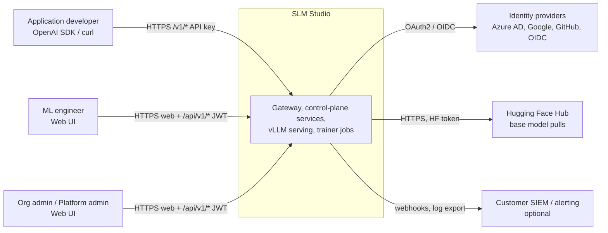
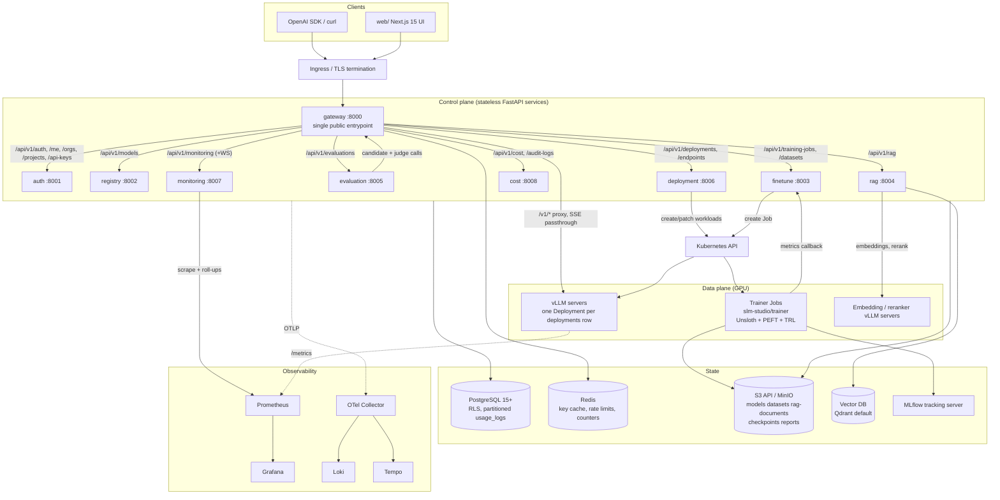
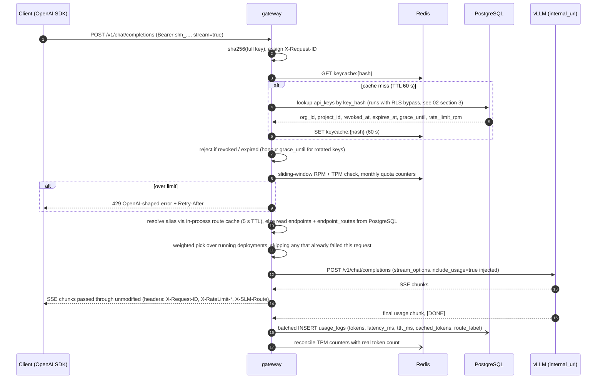
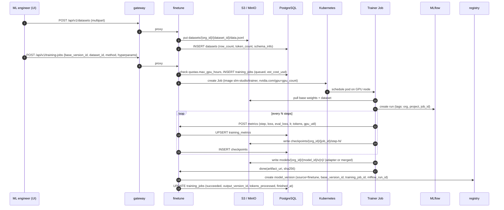
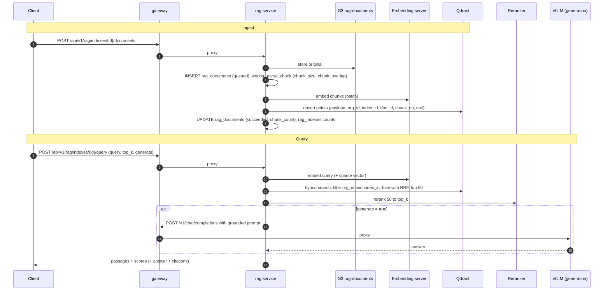
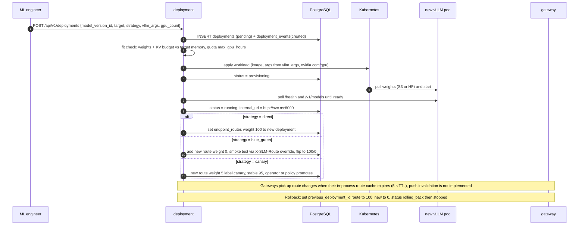

# 01 - Architecture

Status: design. Gateway, auth and registry are implemented; the other control-plane services are typed stubs
(see [README](README.md#implementation-status-as-of-2026-10-14)). Sections describing fine-tune, RAG, deploy
orchestration, monitoring roll-ups and cost roll-ups are the target design.

## 1. Goals and non-goals

Goals

- Serve open-weight SLMs (roughly 1B-14B parameters) to many tenants through an OpenAI-compatible API.
- Let a tenant bring data, fine-tune with LoRA/QLoRA, evaluate, deploy and A/B the result without touching Kubernetes.
- Hard tenant isolation (data, quota, identity), per-tenant cost attribution, auditable control plane.
- Run the same software on a single DGX Spark and on a multi-node H100 Kubernetes cluster.

Non-goals

- Training models from scratch or serving models above ~14B as a first-class use case (they work on the H100 tier; see capacity math).
- Being a general-purpose ML platform (no notebooks, no AutoML).

## 2. Hardware tiers and the DGX Spark vs H100 discrepancy

The brief names both "NVIDIA DGX Spark" and "multi-GPU H100 class". These are not the same class of machine,
so the design defines two tiers. **Assumption A1: confirm which tier is the intended production target.**

| | Tier S: DGX Spark (dev / edge / small team) | Tier P: H100 multi-GPU (production) |
|---|---|---|
| Compute | Single GB10 Grace Blackwell superchip: 20 Arm cores (10 Cortex-X925 + 10 Cortex-A725), Blackwell GPU. NVIDIA quotes up to 1 PFLOP at FP4 *with sparsity* | H100 SXM: ~989 TFLOPS BF16 dense, ~1,979 TFLOPS FP8 dense (spec-sheet figures are quoted with sparsity, double these) |
| Memory | 128 GB LPDDR5x **unified** (CPU and GPU share it), 273 GB/s | 80 GB HBM3 per GPU, ~3.35 TB/s (SXM); 8 GPUs per HGX/DGX node = 640 GB |
| Interconnect | ConnectX-7 (200 Gb/s aggregate) for 2-node clustering, 10 GbE, Wi-Fi 7 | NVLink 900 GB/s intra-node; 400 Gb/s+ InfiniBand/RoCE inter-node |
| Power | 240 W PSU, GB10 TDP ~140 W (Assumption: ~200 W wall average under load) | ~700 W per GPU, ~10 kW per 8-GPU node |
| Architecture | **aarch64** (Arm). Every container must have an arm64 image | x86-64 hosts (usual) |
| Availability | Single node: no redundancy, no hot-swap, no ECC-class guarantees of a datacentre part | N+1 nodes across failure domains |
| Role in SLM Studio | `deploy_target = dgx_spark`: dev, demos, on-prem pilots, small-team inference (a few concurrent users), QLoRA fine-tuning up to ~8B (larger with patience) | `deploy_target = kubernetes / azure / aws / on_prem`: shared multi-tenant serving at scale, faster fine-tuning |

Consequences baked into the design:

1. **Multi-arch images.** CI builds `linux/amd64` and `linux/arm64` for every image; the GPU-specific ones
   (vLLM, trainer) are based on NVIDIA-provided CUDA/vLLM images that support the target (for GB10 this means a
   CUDA 13-era build with Blackwell `sm_121` kernels; **verify that the pinned vLLM image supports GB10 before
   promising a model/quantisation on it**, kernel coverage for new silicon lags).
2. **Unified memory accounting.** On Spark, GPU and OS share the 128 GB. vLLM's `gpu_memory_utilization` is a fraction
   of that pool; leave headroom for the OS, page cache, Postgres/Redis if co-located (recommendation: <= 0.75 on a
   shared Spark). `nvidia-smi` and DCGM framebuffer metrics may report N/A on UMA systems (verify), so capacity
   alarms use node memory metrics plus vLLM's own KV-cache metric ([12-monitoring-design.md](12-monitoring-design.md)).
3. **Bandwidth, not capacity, limits Spark.** 273 GB/s is about 12x lower than one H100's HBM. See section 9.
4. The platform treats "a GPU" as an opaque schedulable `nvidia.com/gpu` resource; `deployments.gpu_count` and
   `deployments.target` are the only hardware-aware fields.

## 3. System context



## 4. Container view



Notes on the diagram:

- `/api/v1/audit-logs` is routed to the auth service. CONTRACT.md section 5 lists it under "Audit" without a
  service; the implemented gateway's prefix map (`Settings.service_map`) sends it to `auth`, which already owns
  org/member/api-key mutations. [03](03-api-spec.md) uses this.
- "Services never call each other's DB tables": cross-service data needs go through HTTP APIs or Postgres via the
  service's own repository module with RLS. The one deliberate exception is that all services use the shared
  `usage_logs` table: gateway writes, monitoring and cost read.
- Evaluation calls the gateway (not vLLM directly) so judged traffic is metered, rate-limited and traced like any other.

## 5. Service responsibilities

Ownership of writes is **Proposed** where the contract is silent; reads are always through RLS.

| Service | Port | Owns (writes) | Responsibilities | Status |
|---|---|---|---|---|
| gateway | 8000 | `usage_logs` | TLS-terminated public entrypoint. `/v1/*`: key lookup, expiry/revoke/grace check, quota + RPM/TPM limits, alias to weighted route, SSE proxy, usage insert, headers. `/api/v1/*`: JWT verify + reverse proxy by prefix. Generates `X-Request-ID` | Implemented |
| auth | 8001 | `users`, `user_identities`, `org_memberships`, `refresh_tokens`, `organizations`, `projects`, `api_keys`, `quotas`, `audit_logs` (writer for its own actions) | Register/login/refresh/logout (argon2id, RS256/HS256 JWT 15 min, opaque refresh with family revoke), OAuth (azure_ad/google/github), org switch, members, projects, API key create/rotate/revoke/usage | Implemented |
| registry | 8002 | `models`, `model_versions` | Model catalogue (global + org), versions, rollback = re-activate older version, benchmark scores, artifact URIs and checksums, licence metadata | Implemented |
| finetune | 8003 | `datasets`, `training_jobs`, `training_metrics`, `checkpoints` | Dataset upload and validation, job lifecycle, Kubernetes Job creation, metrics ingest, cancel, cost estimate (`est_cost_usd`), registers output via registry | Typed stub |
| rag | 8004 | `rag_indexes`, `rag_documents`, vector DB contents | Index lifecycle, ingestion pipeline, hybrid query + rerank, optional grounded generation | Typed stub |
| evaluation | 8005 | `evaluations`, `evaluation_results` | Run metric suites over a dataset for 1..n model versions, LLM-as-judge, comparison | Typed stub |
| deployment | 8006 | `deployments`, `deployment_events`, `endpoints`, `endpoint_routes` | Render and apply vLLM workloads, state machine (`pending`..`rolling_back`), blue/green and canary via route weights, scale, rollback via `previous_deployment_id`, invalidate gateway route cache | Partial: CRUD, RBAC, state machine, scale and rollback (with route repointing) over PostgreSQL are implemented and tested; `target=kubernetes` apply/health-poll still returns 501 (no cluster client wired up), non-Kubernetes targets require `internal_url` to be set manually (e.g. PATCH to the compose `vllm`/`vllm-stub` service) |
| monitoring | 8007 | `usage_logs` partitions (create/drop) | Overview + per-deployment aggregates from Prometheus and `usage_logs`, WebSocket push, partition maintenance | Typed stub |
| cost | 8008 | `cost_rates`, `cost_records` | Daily roll-up of usage and GPU-hours into `cost_records`, summaries by project/deployment/model/org, CSV export | Typed stub |

Deployment-time components that are not services: MLflow tracking server, vector DB, MinIO, vLLM pods, trainer Jobs.

## 6. Request flows

### 6.1 Inference (streaming)



Design requirements that follow from this flow:

- **Usage on streams.** vLLM only emits a `usage` object in a stream when the request sets
  `stream_options.include_usage = true`. The gateway must inject it when absent and drop the extra usage-only
  chunk before forwarding if the client did not ask for it, otherwise token metering silently reads zero.
- **TTFT** is measured at the gateway as time from request receipt to the first SSE `data:` chunk with a delta;
  `latency_ms` is request receipt to final chunk.
- **TPM pre-check** uses an estimate (prompt length by tokenizer-free heuristic + `max_tokens`) and is corrected
  after completion; the estimate must be conservative or tenants can overshoot by one request.
- **Client disconnect** must cancel the upstream request (vLLM aborts the sequence when the HTTP connection closes),
  otherwise GPU time is burned on abandoned streams.
- **Usage write is off the hot path** (in-process bounded queue, batched `INSERT`/`COPY`). If the queue is full the
  request still succeeds and an `slm_gateway_usage_dropped_total` counter increments; losing a billing row must
  be an alert, not an outage.
- **Failure handling.** Upstream connect error or 5xx before the first byte: retry once on another running route
  member (idempotent because nothing was streamed). After first byte: no retry; terminate the stream with an SSE
  error event.

### 6.2 Fine-tuning



The trainer holds **no database credentials**: it only talks to the finetune service (callback token scoped to
one job) and to S3 (scoped credentials per job). **Proposed.** Details of the trainer and MLflow integration
are in [15-mlops-and-rag.md](15-mlops-and-rag.md).

### 6.3 RAG ingest and query



Every Qdrant call carries a mandatory `org_id` payload filter added server-side by the RAG service,
never taken from the request body. Detail in [15](15-mlops-and-rag.md).

### 6.4 Deployment, canary, rollback



Constraint from the contract: `PUT /api/v1/endpoints/{id}/routes` requires weights to sum to 100;
the deployment service also enforces it when it adjusts routes during a strategy.

## 7. Data stores

| Store | Used for | Notes |
|---|---|---|
| PostgreSQL 15+ | All relational state; RLS tenancy; `usage_logs` partitioned by month; `audit_logs` hash chain | `slm_app` role, not owner, not superuser. PgBouncer in **transaction** mode is compatible because `set_config(..., true)` is transaction-local; asyncpg then needs `statement_cache_size=0` (or PgBouncer >= 1.21 with `max_prepared_statements`). Details in [02](02-database-schema.md) |
| Redis | API key cache (60 s), sliding-window rate limits, monthly token counters (seeded from `usage_logs`) | Loss of Redis: the gateway's `ResilientStore` falls back to an in-process store, so limits are enforced per replica instead of globally and inference stays up (verify with a chaos test, [10](10-production-checklist.md) A4); no durable data |
| S3 API (MinIO on-prem) | Buckets `models`, `datasets`, `rag-documents`, `checkpoints`, `reports` | Key prefix `{org_id}/...`; SSE; presigned URLs for browser upload; layout in [15](15-mlops-and-rag.md) |
| Vector DB | RAG chunks | Qdrant default; recommendation and comparison in [15](15-mlops-and-rag.md) |
| MLflow | Experiment tracking for training and eval runs | Backend store = Postgres (separate database), artifacts = S3 (`checkpoints`/`reports` prefix). Not the model registry of record: `model_versions` is |
| Prometheus / Loki / Tempo | Metrics, logs, traces | Retention defaults in [12](12-monitoring-design.md) |

## 8. Multi-tenancy model

Isolation is layered; no single layer is trusted alone.

| Layer | Mechanism | Failure it protects against |
|---|---|---|
| Identity | JWT carries `org` and `role`; API keys resolve to `org_id` (+ `project_id` for project keys) server-side | Client choosing its own tenant |
| Database | `org_id` on every tenant row, `ENABLE` + `FORCE ROW LEVEL SECURITY`, policy `rls_bypass() OR org_id = current_org()`; context via `slm_common.db.tenant_tx` | A missing `WHERE org_id = ...` in a query |
| Cache | Keys namespaced `org:{org_id}:...` except hash-addressed API key entries | Cross-tenant cache poisoning |
| Object storage | Prefix per org; services use scoped credentials; presigned URLs are single-object, short-lived | Path traversal, listing other orgs |
| Vector DB | Server-added `org_id` + `index_id` filter; large tenants get their own collection | Cross-tenant retrieval (a prompt-injection vector as well as a data leak) |
| Compute | Three serving classes, below | Noisy neighbours, data in GPU memory |
| Network | Kubernetes `NetworkPolicy`: vLLM pods accept traffic only from gateway/rag/evaluation; trainer pods have egress only to S3, MLflow, finetune, (HF if allowed) | Lateral movement |
| Quota | `quotas` row per org: RPM, TPM, monthly tokens, monthly USD budget, max GPU-hours | Noisy neighbours, runaway spend |
| Residency | `organizations.data_region`; org is pinned to a region cell | GDPR residency |

**Serving classes** (Assumption A4; the schema has the enum `endpoint_kind` but no semantics):

| `endpoint_kind` | Meaning | Hardware | Billing basis (`cost_rates.resource`) |
|---|---|---|---|
| `shared` | Global-catalogue alias (e.g. `phi-4-mini`) served by platform-owned deployments; many orgs' requests batch together | Shared GPU pool | `input_token_1k`, `output_token_1k` |
| `private` | Org-owned deployment (fine-tuned model or org-registered model) scheduled on the shared GPU pool; only that org's traffic reaches it | Shared pool, org-specific pod | `gpu_hour` while running (replicas x `gpu_count`) |
| `dedicated` | Org-owned deployment pinned to reserved nodes (node pool + taint), no co-tenancy on the GPU | Reserved nodes | `gpu_hour` for the reservation, including idle |

Multi-tenant batching of different orgs inside one vLLM process (`shared`) means prompts from different tenants
share a GPU and KV-cache memory pool. vLLM isolates sequences, and prefix caching is keyed by token-block hash
so a cache hit requires an identical token prefix, but it creates a theoretical timing side channel
(a prefix-cache hit is faster). Orgs with strict requirements use `private` or `dedicated`. Recorded as a
known property in [11-security-checklist.md](11-security-checklist.md). vLLM's cache salting feature, if the pinned
version supports it, should be enabled per org on `shared` deployments (verify).

**LoRA serving for many fine-tunes.** Thousands of orgs each fine-tuning means thousands of artifacts but not
thousands of GPUs: a `private` deployment with `vllm_args.enable_lora = true` serves several adapters on one
base model (`lora_modules`, plus vLLM's `max_loras` / `max_lora_rank`), and adapters can be loaded at runtime
(requires `VLLM_ALLOW_RUNTIME_LORA_UPDATING=True`). **Proposed:** an endpoint route targets
`(deployment_id)` and the adapter name is `vllm_args.lora_modules[*].name`; the gateway rewrites `model` to the
adapter name when it forwards. The contract does not yet define how the adapter name is carried; open question OQ-3 in [14](14-roadmap.md).

## 9. Capacity and scaling

All figures here are planning values from a first-principles model. **Assumption A2: they are not
measurements; run a benchmark (vLLM `benchmark_serving`-style, with your real prompt/completion length
distribution) before buying hardware or promising an SLA.**

### 9.1 Method

Autoregressive decode is memory-bandwidth-bound at the batch sizes that matter: every step streams the
weights once plus every active sequence's KV cache.

```
step_time  = (W + B * kv_per_token * ctx) / (BW * eta)
decode_tps = B / step_time                       # aggregate tokens/s across the batch
prefill_tps ~ MFU * peak_FLOPs / (2 * params)    # compute-bound
GPU-seconds per request = prompt_tokens / prefill_tps + completion_tokens / decode_tps
```

Inputs: `W` weight bytes (FP8 = 1 byte/param); `kv_per_token` for Llama-3.1-8B and Phi-4-mini = 32 layers x 8 KV heads
x 128 head-dim x 2 (K and V) = 64 KiB at FP8 KV cache (128 KiB at BF16); `ctx` = 1,500 tokens average;
`BW` = 273 GB/s (Spark) or 3.35 TB/s (H100 SXM); `eta` = 0.70 (Spark, effective fraction of peak bandwidth).

Roofline results (Llama-3.1-8B FP8 weights, FP8 KV, 1,500-token context):

| Batch B | Spark (eta=0.70, 191 GB/s) step ms | Spark tok/s | H100 (BW 2.0 TB/s eff.) step ms | H100 tok/s |
|---|---|---|---|---|
| 1 | 42.6 | 23 | - | - |
| 8 | 46.2 | 173 | - | - |
| 16 | 50.4 | 318 | - | - |
| 32 | 58.7 | 545 | 5.6 | 5,740 |
| 64 | 75.2 | 851 | - | - |
| 128 | - | - | 10.3 | 12,440 |

Roofline is an upper bound. Planning values used in the rest of the docs apply a derate for scheduler overhead,
attention-kernel efficiency, mixed prefill/decode interference and latency SLOs that cap the batch size:

| Planning point | Decode tok/s (aggregate) | Prefill tok/s | Basis |
|---|---|---|---|
| Spark, Phi-4-mini 3.8B FP8 | 600 | 12,000 | ~70% of roofline at B=32 (875) |
| Spark, Llama-3.1-8B FP8 | 380 | 6,000 | ~70% of roofline at B=32 (545) |
| H100, Phi-4-mini 3.8B FP8 | 8,000 | 80,000 | 2x the 8B figure (Assumption) |
| H100, Llama-3.1-8B FP8 | 4,000 | 40,000 | ~1/3 of roofline at B=128: deliberately conservative |
| H100, Phi-4 14B FP8 | 2,200 | 22,000 | Scaled from 8B by weight bytes (Assumption) |

Sanity check against published third-party measurements: independent reviews of DGX Spark in late 2025
reported single-stream decode in the ~20 tok/s range for an 8B FP8 model (model above: 23) and aggregate in the
hundreds of tok/s at batch 32, which is consistent. The Spark prefill planning value is also
in line with published ~8k tok/s for 8B-class FP8. Re-measure on your build.

Large models on Spark: Llama-3.3-70B at 4-bit (~35 GB weights) fits in 128 GB but roofline decode at B=1 is
about `191 / 35 = 5.5 tok/s`; usable only for batch/offline jobs. This is why the product scopes to 1B-14B.

KV-cache capacity is not the Spark constraint: with `gpu_memory_utilization = 0.75` (96 GB), an 8B FP8 model
leaves ~88 GB for KV = ~1.3 M tokens at 64 KiB/token, i.e. about 900 concurrent 1,500-token sequences. Bandwidth saturates long before that.

### 9.2 Workload definition and sizing

Assumptions: average request = 800 prompt + 250 completion tokens (RAG-heavy workloads are higher; scale
`prefill` linearly); peak-to-average ratio 4x (business-hour clustering); target utilisation 60% at peak
(headroom for failures, deploys and bursts).

GPU-seconds per request, per unit capacity (`1 / GPU-seconds`), and sustainable rps at 60%:

| Unit | GPU-s/request | Max rps at 100% | Sustainable rps at 60% |
|---|---|---|---|
| Spark, Phi-4-mini FP8 | 0.483 | 2.07 | 1.24 |
| Spark, Llama-3.1-8B FP8 | 0.791 | 1.26 | 0.76 |
| H100 (1 GPU), Phi-4-mini FP8 | 0.041 | 24.2 | 14.5 |
| H100 (1 GPU), Llama-3.1-8B FP8 | 0.0825 | 12.1 | 7.27 |
| H100 (1 GPU), Phi-4 14B FP8 | 0.150 | 6.67 | 4.00 |

Traffic scenarios: 100k, 1M, 10M requests/day = 1.16, 11.6, 116 rps average = 4.6, 46.3, 463 rps at peak
= (0.93k, 9.3k, 92.6k) prompt tok/s average and (0.29k, 2.9k, 28.9k) completion tok/s average.

Units required at **peak** (ceil of peak rps / sustainable rps), before redundancy:

| Unit | 100k req/day | 1M req/day | 10M req/day |
|---|---|---|---|
| Spark, Phi-4-mini FP8 | 4 | 38 | 373 |
| Spark, Llama-3.1-8B FP8 | 7 | 62 | 611 |
| H100 GPU, Phi-4-mini FP8 | 1 | 4 | 32 |
| H100 GPU, Llama-3.1-8B FP8 | 1 | 7 | 64 |
| H100 GPU, Phi-4 14B FP8 | 2 | 12 | 116 |

Reading the table:

- **One DGX Spark is a team-scale or edge appliance**: roughly 50-100k requests/day of 8B-class traffic at
  60% utilisation with a 4x peak (0.76 rps x 86,400 s = 66k at a flat 60%). Above ~100k requests/day the Spark
  tier stops making sense operationally, even though the arithmetic says "buy 62 of them" for 1M/day.
- **1M requests/day on an 8B model fits in one 8-GPU H100 node** (7 GPUs at peak) with no redundancy. With N+1
  node redundancy for HA (two nodes, 16 GPUs) there is ample room, which makes the HA design (two nodes) the
  sizing driver, not throughput.
- **10M requests/day** is 64 H100s for an 8B model (8 nodes) before redundancy. Real tenants will not all use
  one model, which fragments capacity: each distinct base model needs at least 1 GPU (2 for HA) regardless of
  load. The mitigation is to constrain the global catalogue to a small set of shared base models and serve
  per-org fine-tunes as LoRA adapters (section 8, "LoRA serving").
- **Thousands of orgs, most idle.** Fleet size is driven by the *sum of peaks of active tenants* and by the number of
  distinct base models, not by org count. Orgs on `shared` endpoints cost nothing when idle. `private` and
  `dedicated` deployments consume GPUs when idle unless `replicas_min = 0` (scale to zero); cold start is
  weights load (an 8B FP8 model is ~8 GB, ~3-10 s from local NVMe at 1-3 GB/s) plus CUDA graph capture and
  warm-up (Assumption: 30-90 s), so scale-to-zero is a cost option for dev/test deployments, not for interactive production.
- Memory fit on H100 (80 GB): 14B FP8 = 14 GB weights; with `gpu_memory_utilization = 0.90` (72 GB) the KV
  budget is ~58 GB; Phi-4 (40 layers, 10 KV heads, head-dim 128: 40 x 10 x 128 x 2 x 1 B = 100 KiB/token at FP8 KV)
  gives ~570k tokens, about 380 concurrent 1,500-token sequences per GPU.

### 9.3 Control-plane scaling

| Component | Load at 1M req/day (46 rps peak) | Load at 10M/day (463 rps peak) | Scaling approach |
|---|---|---|---|
| Gateway (async proxy) | Concurrent streams by Little's law: `rps x mean duration` = 46 x 4 s = ~185 | 463 x 4 s = ~1,850 | Stateless, HPA on CPU + in-flight requests. Assumption: ~500 rps/replica for proxying; 3 replicas minimum for HA. Load test |
| Redis ops | ~4 ops/request (key cache GET, limiter EVALSHA, counters, route GET) = ~190 ops/s | ~1.9k ops/s | One primary + replica is enough to ~20k ops/s; Redis Cluster only beyond ~100M req/day |
| `usage_logs` inserts | 11.6 rows/s average | 116 rows/s (463 peak) | Batched `COPY`/multi-row insert; trivial for one primary |
| `usage_logs` volume | ~170 B/row heap, ~2x with two indexes: 1M rows ~0.34 GB/day (~10 GB/month) | 10M rows ~3.4 GB/day (~100 GB/month) | Monthly partitions, retention policy in [02](02-database-schema.md) |
| Postgres connections | gateway batches; control-plane services short transactions | same | PgBouncer transaction pooling; one primary + 1-2 replicas; read replica for monitoring/cost queries |
| vLLM data plane | See 9.2 | See 9.2 | One Kubernetes Deployment per `deployments` row; replicas between `replicas_min` and `replicas_max`; HPA on `vllm:num_requests_waiting` and KV-cache usage (custom metrics via Prometheus adapter or KEDA) |

Beyond a single region/cluster: **cell architecture** (Proposed). A cell is a complete stack (Kubernetes cluster,
Postgres, Redis, object store, vector DB). Orgs are pinned to a cell by `organizations.data_region`; a thin global
directory (DNS or a small routing service in front of the gateways) maps org to cell. This is the scaling
unit for more than ~1,000 busy orgs per cell (Assumption) and it is the same mechanism that delivers GDPR data residency. The MVP
is a single cell; the cell directory is Phase 4 in [14-roadmap.md](14-roadmap.md).

### 9.4 Fine-tuning capacity

Training cost scales with tokens processed: `FLOPs ~ 6 * params * tokens` (LoRA/QLoRA lowers the weight-gradient
cost but adds dequantisation overhead; 6N is a conservative round number). For 8B: 48 GFLOP/token.

| Tier | Assumed sustained throughput, 8B QLoRA | 60 M tokens (20 M x 3 epochs) |
|---|---|---|
| Spark | ~1,200 tok/s (~30% of ~125 TFLOPS BF16 dense, plus Unsloth speedup; Assumption) | ~13.9 h |
| 1x H100 | ~6,000 tok/s (Assumption) | ~2.8 h |

Fine-tuning and serving compete for GPUs. On the Spark tier a running training job and a vLLM server share the
same 273 GB/s and 128 GB: **run training outside serving hours or on a separate Spark**; the
deployment service must refuse to schedule a trainer if `gpu_memory_utilization` of resident vLLM pods plus the
trainer's estimate exceeds the node budget. On the H100 tier use a dedicated training node pool (taint
`slm.studio/workload=train`) so a long job cannot evict inference.

## 10. Failure modes

| Failure | Behaviour | Mitigation |
|---|---|---|
| vLLM pod crash mid-stream | Stream ends with SSE error; usage row written with status 502 | Client retry; readiness probe removes pod; gateway retries only pre-first-byte |
| All routes of an alias down | 503 OpenAI-shaped error, code `no_healthy_deployment` | Alert on aliases with zero running deployments |
| Redis down | Gateway degrades to per-replica in-process limits and key cache (implemented, `ResilientStore`); global limits are weaker by a factor of the replica count | Alert on Redis down; the fail-open choice is documented in [10](10-production-checklist.md) |
| Postgres primary down | Control plane returns 503; **inference continues** from cached keys/routes for up to the cache TTL, usage rows buffer in memory then spill/drop with counter | Patroni/CNPG failover; RPO/RTO in [06](06-infrastructure.md) |
| Trainer OOM | Job `failed`, `error` populated, last checkpoint retained | Fit estimator before launch; auto-resume from last checkpoint is Phase 3 |
| Noisy tenant | Per-org RPM/TPM 429s; vLLM `max_num_seqs` bounds batch | Per-org concurrency cap in gateway (Proposed, Phase 2) |

## 11. Key decisions

| Decision | Choice | Rejected alternative and why |
|---|---|---|
| Inference engine | vLLM | TGI/SGLang/TensorRT-LLM: vLLM has the broadest model and LoRA coverage and an OpenAI server built in; the engine sits behind `internal_url` so it can be swapped per deployment later |
| Tenancy in DB | Shared schema + RLS | Schema-per-tenant (migration fan-out at thousands of orgs), DB-per-tenant (cost) |
| DB access | asyncpg + repository modules, no ORM | ORM: RLS needs explicit per-transaction `set_config`; raw SQL keeps policies visible |
| Gateway as the only public entrypoint | Single choke point for auth, limits, metering | Per-service ingress: duplicates auth and rate limiting |
| Usage metering at the gateway | Tokens from upstream `usage` | Parsing Prometheus counters: cannot attribute to org/key |
| Training on Kubernetes Jobs | One Job per run, image `slm-studio/trainer` | In-process training in a service: no isolation, no GPU scheduling |
| Vector DB default | Qdrant | See [15](15-mlops-and-rag.md#6-vector-database-comparison-and-recommendation) |
