# 02 - Database Schema

Source of truth: [`db/migrations/0001_init.sql`](../db/migrations/0001_init.sql) (PostgreSQL 15+, extensions
`pgcrypto`, `citext`). This document explains it, records design intent that the SQL cannot express, and lists
gaps that need a follow-up migration. If this document and the SQL disagree, the SQL wins and this document is a bug.

PostgreSQL 15 is a hard minimum: the schema uses `ON DELETE SET NULL (column_list)` (a PG 15 feature) in
composite foreign keys.

## 1. ER diagram

Only identifying columns, foreign keys and the columns that carry design meaning are shown. Dotted lines are soft
references without a foreign key (by design, for write throughput or append-only semantics).

```mermaid
erDiagram
    organizations ||--o{ org_memberships : has
    users ||--o{ org_memberships : joins
    users ||--o{ user_identities : "sso links"
    users ||--o{ refresh_tokens : holds
    organizations ||--o{ projects : owns
    organizations ||--o{ api_keys : owns
    projects |o--o{ api_keys : "project scope"
    api_keys |o--o| api_keys : "rotated_from"
    organizations ||--|| quotas : limits
    organizations |o--o{ models : "org models (NULL = global)"
    models ||--o{ model_versions : versions
    model_versions |o--o{ model_versions : "base_version_id"
    model_versions ||--o{ deployments : served_by
    deployments ||--o{ deployment_events : history
    deployments |o--o| deployments : "previous_deployment_id"
    organizations ||--o{ endpoints : exposes
    endpoints ||--o{ endpoint_routes : routes
    deployments ||--o{ endpoint_routes : target
    organizations ||--o{ datasets : owns
    datasets ||--o{ training_jobs : trains_on
    model_versions ||--o{ training_jobs : "base_version_id"
    training_jobs |o--o| model_versions : "output_version_id"
    training_jobs ||--o{ training_metrics : logs
    training_jobs ||--o{ checkpoints : saves
    organizations ||--o{ rag_indexes : owns
    rag_indexes ||--o{ rag_documents : contains
    datasets ||--o{ evaluations : evaluated_on
    evaluations ||--o{ evaluation_results : produces
    model_versions ||--o{ evaluation_results : scored
    organizations ||--o{ cost_records : accrues
    organizations }o..o{ usage_logs : "no FK"
    organizations }o..o{ audit_logs : "no FK"

    organizations {
        uuid id PK
        citext slug UK
        text plan
        text data_region
        timestamptz deleted_at
    }
    users {
        uuid id PK
        citext email UK
        text password_hash
        boolean is_platform_admin
        bytea mfa_secret_enc
        timestamptz deleted_at
    }
    org_memberships {
        uuid org_id PK
        uuid user_id PK
        org_role role
    }
    projects {
        uuid id PK
        uuid org_id FK
        citext slug
    }
    api_keys {
        uuid id PK
        uuid org_id FK
        uuid project_id FK
        api_key_scope scope
        text prefix
        bytea key_hash UK
        timestamptz grace_until
        timestamptz revoked_at
    }
    quotas {
        uuid org_id PK
        int rpm_limit
        int tpm_limit
        bigint monthly_token_limit
        numeric monthly_budget_usd
        numeric max_gpu_hours
    }
    models {
        uuid id PK
        uuid org_id FK "NULL = global"
        text name
        model_source source
        text license
    }
    model_versions {
        uuid id PK
        uuid model_id FK
        uuid org_id FK
        int version
        version_status status
        text artifact_uri
        uuid base_version_id FK
        uuid training_job_id FK
        jsonb benchmark_scores
    }
    deployments {
        uuid id PK
        uuid org_id FK
        uuid model_version_id FK
        endpoint_kind kind
        deploy_target target
        deploy_strategy strategy
        deploy_status status
        jsonb vllm_args
        text internal_url
        uuid previous_deployment_id FK
    }
    endpoints {
        uuid id PK
        uuid org_id FK
        text alias
        boolean enabled
    }
    endpoint_routes {
        uuid endpoint_id PK
        uuid deployment_id PK
        uuid org_id FK
        int weight
        text label
    }
    datasets {
        uuid id PK
        uuid org_id FK
        text purpose
        text storage_uri
    }
    training_jobs {
        uuid id PK
        uuid org_id FK
        uuid base_version_id FK
        uuid dataset_id FK
        tune_method method
        job_status status
        uuid output_version_id FK
        numeric est_cost_usd
    }
    training_metrics {
        uuid job_id PK
        int step PK
        double loss
    }
    checkpoints {
        uuid id PK
        uuid job_id FK
        int step
        text uri
    }
    rag_indexes {
        uuid id PK
        uuid org_id FK
        vector_backend backend
        text collection
        int embedding_dim
        index_status status
    }
    rag_documents {
        uuid id PK
        uuid index_id FK
        job_status status
    }
    evaluations {
        uuid id PK
        uuid org_id FK
        uuid dataset_id FK
        uuid[] model_version_ids
        text[] metrics
    }
    evaluation_results {
        uuid evaluation_id PK
        uuid model_version_id PK
        jsonb scores
    }
    usage_logs {
        bigint id PK
        timestamptz created_at PK
        uuid org_id
        uuid api_key_id
        uuid deployment_id
        int prompt_tokens
        int completion_tokens
    }
    cost_records {
        date day
        uuid org_id FK
        text resource
        numeric usd
    }
    audit_logs {
        bigint id PK
        uuid org_id
        text action
        bytea prev_hash
        bytea row_hash
    }
```



Not shown: `deployment_events` (child of `deployments`), `cost_rates` (global rate card, no tenant column).

## 2. Conventions

| Topic | Convention |
|---|---|
| Keys | `uuid` primary keys from `gen_random_uuid()` (`pgcrypto`); `bigint` identity only for append-only high-volume tables (`usage_logs`, `audit_logs`, `deployment_events`) |
| Time | `timestamptz` everywhere, UTC. `created_at` default `now()`; `updated_at` maintained by trigger `set_updated_at` on organizations, users, projects, models, deployments, endpoints, quotas |
| Soft delete | `deleted_at` on organizations, users, projects; `archived_at` on models. Queries must filter; there is no view layer yet |
| Case-insensitive text | `citext` for emails and slugs |
| Enumerations | Native enum types (14 of them). Adding a value is `ALTER TYPE ... ADD VALUE`; a value cannot be removed, and in PG 12+ a new value cannot be used in the same transaction that adds it: see migration policy |
| Tenant column | `org_id uuid` on every tenant-owned row, including child tables (`training_metrics`, `checkpoints`, `endpoint_routes`, `evaluation_results`, `deployment_events`, `rag_documents`) so RLS policies never need a join |

## 3. Row-level security model

Mechanics (verbatim from the migration):

- `current_org()` returns `NULLIF(current_setting('app.org_id', true), '')::uuid`.
- `rls_bypass()` returns true when `app.bypass_rls = 'on'`.
- Generic policy `tenant_isolation` on 18 tables (17 after `model_versions` swaps it for its own policies): `USING (rls_bypass() OR org_id = current_org())` and the same `WITH CHECK`.
- `ENABLE` **and** `FORCE ROW LEVEL SECURITY`: policies also apply to the table owner.
- Services connect as `slm_app` (not superuser, not owner). Each transaction starts with
  `SELECT set_config('app.org_id', '<uuid>', true)` (the `true` = transaction-local) via `slm_common.db.tenant_tx`.
- Fail closed: with no `app.org_id`, `current_org()` is NULL, `org_id = NULL` is not true, no rows are visible or insertable.

Coverage:

| Table | RLS | Policy | Access path |
|---|---|---|---|
| projects, api_keys, quotas, deployments, deployment_events, endpoints, endpoint_routes, datasets, training_jobs, training_metrics, checkpoints, rag_indexes, rag_documents, evaluations, evaluation_results, usage_logs, cost_records | Yes | `tenant_isolation` | `tenant_tx(pool, org_id)` |
| models | Yes | `models_read` (SELECT: bypass or `org_id IS NULL` or own org); `models_write` (ALL: bypass or own org) | Global catalogue rows are readable by all, writable only under bypass |
| model_versions | Yes | `mv_read`, `mv_write` (same rule as models; the generic policy is dropped) | same |
| audit_logs | Yes | `audit_read` (bypass or own org); `audit_insert` `WITH CHECK (true)` | Anyone with a context can append; tenants read only their own |
| organizations, users, user_identities, org_memberships, refresh_tokens, cost_rates | **No** | - | Auth service logic + GRANTs only (see gaps) |

### Properties and limits of this model (read before relying on it)

1. **RLS protects against forgotten `WHERE` clauses, not against code that can issue arbitrary SQL.**
   `app.bypass_rls` is an ordinary custom setting: any session running as `slm_app` can execute
   `set_config('app.bypass_rls','on',true)` (for example through a SQL-injection flaw or a compromised service).
   PostgreSQL cannot restrict who may set a custom GUC, so the fix is structural. Recommendation (follow-up migration
   `0002`, Phase 2): remove the GUC bypass and use a separate login role for the services that legitimately need
   cross-tenant reads (auth, gateway key lookup, monitoring/cost roll-ups) with the `BYPASSRLS` attribute, or
   narrow `SECURITY DEFINER` functions for specific lookups. Until then treat every `slm_app` connection as capable
   of bypass and rely on code review plus ruff `S` rules (SQL-injection checks, enabled in the repo's `pyproject.toml`
   except `S608`, which is ignored, so string-built SQL must be caught in review) to prevent injectable SQL.
2. **The gateway's API-key lookup happens before the org is known** and `api_keys` has RLS keyed on `org_id`.
   The implemented gateway therefore runs `tenant_tx(pool, None, bypass=True)` for key lookup (`keys.py`), alias/route
   resolution (`routing.py`) and usage inserts (`usage.py`): three bypass paths on the internet-facing service.
   A `SECURITY DEFINER` function `resolve_api_key(key_hash bytea)` returning only
   `(id, org_id, project_id, scope, rate_limit_rpm, expires_at, grace_until, revoked_at)`, plus narrow
   functions for route resolution and usage insert, would shrink that bypass surface. Open question OQ-1 in [14-roadmap.md](14-roadmap.md).
3. **Foreign-key checks bypass RLS.** FK validation reads the referenced table with the owner's rights, so
   `deployments.model_version_id`, `training_jobs.base_version_id / dataset_id`, `evaluations.dataset_id`, and
   `endpoint_routes.deployment_id` accept a valid UUID belonging to *another org*, and success/failure leaks the
   UUID's existence. Only `(org_id, project_id) -> projects(org_id, id)` is a composite FK that enforces same-tenant.
   Mitigation today: services must resolve every referenced id through a tenant-scoped `SELECT` first (RLS hides foreign rows).
   Hardening (`0002`): add `UNIQUE (org_id, id)` to referenced tables and composite FKs; global-catalogue
   `model_versions` (NULL `org_id`) need a CHECK/trigger variant.
4. **Partitioned `usage_logs`.** Policies on the parent apply to queries through the parent. A query directly on a
   partition (`usage_logs_2026_10`) is governed by that partition's own RLS setting. Grant `slm_app` privileges on the
   parent only, own all partitions as the migration role, and create new partitions from a template that also enables RLS.
5. **Seed data and `FORCE RLS`.** The migration inserts global `models` rows (`org_id` NULL) after `FORCE`-ing RLS
   with no `set_config('app.bypass_rls','on',true)`. This succeeds only if the migration role is a superuser or has
   `BYPASSRLS`. Migration policy therefore requires such a role (section 8), or the seed block must set the GUC.
6. **`audit_insert` is `WITH CHECK (true)`.** A service under tenant A's context can insert an audit row stamped with
   tenant B's `org_id`. Detection relies on the hash chain and on only `slm_common.audit` writing the table. Hardening: `WITH CHECK (org_id IS NULL OR org_id = current_org() OR rls_bypass())`.
7. **No `TO role` clauses**: policies apply to PUBLIC. Acceptable because only `slm_app` and the migration role connect; keep it that way.
8. Defence in depth for the tables without RLS: auth service is the only writer; read paths always filter by the `org`
   claim; `organizations`/`users` are never exposed through a list endpoint except to `platform_admin`.

## 4. Table notes

### Identity and tenancy

| Table | Notes |
|---|---|
| `organizations` | `slug` unique `citext`. `plan` free text (`free` default) - plan names are product config, not an enum. `data_region` default `'eu'` drives residency cell selection. `deleted_at` soft delete; hard delete is a scheduled job (section 6) |
| `users` | Global (not tenant-owned): one person, many orgs via memberships. `password_hash` NULL for SSO-only users. `is_platform_admin` is the `platform_admin` role. `mfa_secret_enc` is ciphertext (application-level encryption, key from secret mount); TOTP only. GDPR erasure = anonymise fields + set `deleted_at` (email replaced by `deleted-<uuid>@invalid`) |
| `user_identities` | `UNIQUE (provider, subject)`; providers: `azure_ad`, `google`, `github`, `oidc`. Cascade on user delete |
| `org_memberships` | PK `(org_id, user_id)`; role is `org_role`. `platform_admin` is not stored here. Index on `user_id` for "my orgs" |
| `refresh_tokens` | Stores only `token_hash` (sha256, unique). `family_id` groups a rotation chain: presenting an already-rotated token revokes the entire family. Purge job in section 6 |
| `projects` | `UNIQUE (org_id, slug)` and `UNIQUE (org_id, id)` (the latter exists only as the target of composite FKs) |
| `api_keys` | Plaintext is never stored. **Hash discrepancy to resolve:** the column comment says `sha256(secret)`; CONTRACT.md section 2 says `sha256(full key)` where the key is `slm_<8 char prefix>_<40 char secret>`. The contract is binding: hash the **full key string**; the comment is stale. `prefix` holds the display prefix (the comment gives `slm_a1b2`, 8 characters, while the key format has an 8-character prefix after `slm_`; the UI shows `prefix` only, so either is safe, but pick one and document it in `slm_common.security`). `CHECK ((scope='project') = (project_id IS NOT NULL))`. Rotation: new row with `rotated_from` -> old id, old row gets `grace_until`; gateway honours the old key until then. `rate_limit_rpm` NULL means org default from `quotas` |
| `quotas` | One row per org (PK `org_id`). Defaults 600 RPM, 200,000 TPM. NULL `monthly_*`/`max_gpu_hours` = unlimited. Enforcement: RPM/TPM in Redis (gateway), monthly tokens and budget from Redis counters seeded from `usage_logs`/`cost_records`, GPU-hours by deployment and finetune services at create time |

### Registry

| Table | Notes |
|---|---|
| `models` | `org_id` NULL = global catalogue. Unique per `(COALESCE(org_id, nil-uuid), name)` via expression index `models_name_uq`. `license` is a free-text label; the seed uses `MIT`, `Llama 3.1`, `Gemma`, `Apache-2.0`. See licence caveats in [14](14-roadmap.md#5-model-licence-caveats) |
| `model_versions` | `UNIQUE (model_id, version)`. `artifact_uri` is `s3://...` or `hf://...`. `base_version_id` gives fine-tune lineage; `training_job_id` FK added after `training_jobs` exists; `mlflow_run_id` links to MLflow. `benchmark_scores` JSONB (`{"accuracy":0.81,...}`) is written by evaluation via the registry PATCH. `status`: `registered` -> `active` -> `archived`; rollback re-activates an older version |

### Serving

| Table | Notes |
|---|---|
| `deployments` | `UNIQUE (org_id, name)`. `vllm_args` JSONB holds the whitelisted vLLM flags (`max_model_len`, `gpu_memory_utilization`, `enable_prefix_caching`, `speculative_config`, `max_num_seqs`, `max_num_batched_tokens`, `quantization`, `enable_lora`, `lora_modules`); the deployment service validates keys and ranges (never pass through arbitrary args). `internal_url` is set when `running`. `previous_deployment_id` is the rollback pointer. `project_id` is `SET NULL` when a project is deleted. No CHECK on `replicas_min <= replicas_max` or `gpu_count >= 1`: add in `0002` |
| `deployment_events` | Append-style history (`bigserial`), not covered by the audit trigger. Index `(deployment_id, created_at DESC)` |
| `endpoints` | `alias` is the `model` value clients send; `UNIQUE (org_id, alias)`. Global shared aliases: **Proposed** to model them as `endpoints` rows owned by a platform org with `kind = 'shared'` and a resolution rule "own alias first, then shared" in the gateway; the contract says only that shared aliases "also resolve" |
| `endpoint_routes` | PK `(endpoint_id, deployment_id)`; `weight` 0-100; the "sum to 100" rule is enforced in the API (a DB constraint would need a deferred trigger). `label` is `stable`, `canary`, `variant-b`; the gateway returns it in `X-SLM-Route` and `usage_logs.route_label` |

### Fine-tuning

| Table | Notes |
|---|---|
| `datasets` | `purpose` in (`finetune`, `eval`). `storage_uri` points into the `datasets` bucket. `schema_info` records detected columns/format (instruction, chat, completion). No content hash column: add `sha256` in `0002` for lineage integrity |
| `training_jobs` | `hyperparams` JSONB NOT NULL. `k8s_job_name`, `mlflow_run_id`, `wandb_run_url` link out. `output_version_id` set on success. `est_cost_usd` is the pre-run estimate ([13](13-cost-estimation.md)); actual cost goes to `cost_records` (`train_token_1k` and `gpu_hour`) |
| `training_metrics` | PK `(job_id, step)`; written at a bounded rate (every N steps, default 10) to keep volume small. Retained with the job |
| `checkpoints` | `UNIQUE (job_id, step)`; `uri` in the `checkpoints` bucket. Lifecycle rule prunes all but the last K and the best checkpoint |

### RAG and evaluation

| Table | Notes |
|---|---|
| `rag_indexes` | `collection` is the physical vector-DB collection name; several indexes may share one collection and be separated by an `index_id` payload filter (recommended default). `embedding_model` + `embedding_dim` are immutable after creation (changing them means re-embedding: create a new index). `hybrid_search` default true, `reranker_model` optional |
| `rag_documents` | One row per uploaded file; `status` reuses `job_status` (`queued`/`running`/`succeeded`/`failed`). Chunk text lives in the vector DB payload, not in Postgres |
| `evaluations` | `model_version_ids uuid[]` (no FK possible on array elements: the service validates). `metrics text[]` from the allowed set `accuracy, f1, rouge, bleu, hallucination, faithfulness, groundedness, toxicity, json_validity` (also latency, cost via `evaluation_results`). `judge_model` is an endpoint alias |
| `evaluation_results` | PK `(evaluation_id, model_version_id)`; `scores` JSONB. Per-sample outputs are **not** in the schema: they go to a `reports` bucket artifact (`reports/{org_id}/evaluations/{id}/samples.jsonl`); the UI's per-sample drill-down needs that or a new table |

### Usage, cost, audit

| Table | Notes |
|---|---|
| `usage_logs` | `PARTITION BY RANGE (created_at)`, PK `(id, created_at)`, plus `usage_logs_default`. No foreign keys (throughput; rows must outlive deleted deployments/keys). `ttft_ms` and `cached_tokens` (prefix-cache hits reported by vLLM `prompt_tokens_details`, if available) support latency and cost analytics. `status_code` smallint |
| `cost_rates` | Global rate card: `resource` in `gpu_hour`, `input_token_1k`, `output_token_1k`, `storage_gb_month`, `train_token_1k`; `gpu_type` optional; `effective_from` date for versioned prices (pick the latest row with `effective_from <= day`). **No `org_id`**: per-org negotiated rates or a margin multiplier need a new column or table (see [13](13-cost-estimation.md)) |
| `cost_records` | Daily roll-up. Uniqueness is the expression index `cost_records_uq (day, org_id, resource, COALESCE(deployment_id), COALESCE(project_id))` and is the `ON CONFLICT` target. `model_version_id` is **not** part of the key: if a deployment's model version changes within a day the second value overwrites or merges into the first, losing per-version attribution. Either roll up by `(deployment_id)` only (current behaviour) or extend the index in `0002` |
| `audit_logs` | Append-only. Trigger `audit_logs_no_update` (`BEFORE UPDATE OR DELETE`, row-level) raises. `TRUNCATE` is **not** blocked: add a statement-level `BEFORE TRUNCATE` trigger and `REVOKE TRUNCATE`. `prev_hash`/`row_hash` implement the tamper-evidence chain (section 5). `ip` is `inet`: personal data under GDPR |

## 5. Audit log hash chain

Columns `prev_hash` / `row_hash` exist in `0001`; the chain is computed in application code, `slm_common.audit.audit(...)`
(not in a trigger). **Implemented behaviour** (read from `services/common/src/slm_common/audit.py`, 2026-10-14):

```
lock     = SELECT pg_advisory_xact_lock(hashtextextended(str(org_id), 0))     -- serialises appends per chain, released at commit
prev     = row_hash of the newest audit row for the same org (org_id IS NOT DISTINCT FROM), or NULL for the first row
record   = {org_id, actor_id, actor_type, action, resource, resource_id, detail, created_at(isoformat)}
row_hash = SHA-256( prev || json.dumps(record, sort_keys=True, separators=(",", ":"), default=str) )
insert   = the row incl. ip, request_id, prev_hash=prev, row_hash, created_at, on the caller's transaction
```

Properties and gaps (what to fix in `0002` / the next audit-helper release):

| Observation | Consequence | Recommendation |
|---|---|---|
| The audit row is inserted on the **caller's transaction**, under the advisory lock | The audit record commits atomically with the change it describes, and chain order equals commit order | Keep. Long transactions hold the org's audit lock: keep mutation transactions short |
| `ip` and `request_id` are stored but **not part of the hashed record** | An attacker with write access can change `ip` or `request_id` without breaking the chain | Hash them too (introduce a `chain_version` in `detail` or a new column) |
| `prev_hash` is NULL (not 32 zero bytes) for the first row | Fine, but verifiers must treat NULL as the empty prefix | Document in the verifier |
| Platform chain (`org_id` NULL) is locked with the key `"None"` | Works, but all NULL-org events share one lock | Acceptable |
| Hash covers `detail` via `default=str` serialisation | Any change in `str()` of a type (UUID, datetime, Decimal) alters hashes | Restrict `detail` to JSON-native types |
| `_client_ip` takes the first `X-Forwarded-For` value unconditionally (the gateway has a separate `trust_forwarded_for = False` setting, the audit helper does not) | A client can forge the audited IP unless the ingress overwrites `X-Forwarded-For` | Honour the header only from a trusted proxy list, or pass the verified client IP from the gateway |
| No verifier job and no external anchor exist yet | Tamper evidence is theoretical until someone verifies | Section below |

Still to build:

- **Verifier** (monitoring service, nightly): recompute each org's chain in `id` order from the last verified anchor using exactly the algorithm above; a mismatch is a P1 alert.
- **Anchoring.** A privileged DB user can disable the trigger and rewrite the whole chain consistently. Daily, write the latest `row_hash` per chain to an external immutable location (S3 Object Lock bucket in compliance mode, or an external timestamping service). Verification starts from that anchor.
- Do not store secrets in `detail` (no key plaintext, no passwords, no prompt content).

## 6. Partitioning and retention

| Data | Mechanism | Default retention (Assumption, configurable per plan) | Notes |
|---|---|---|---|
| `usage_logs` | Monthly range partitions, created by the monitoring service (`pg_partman` in production, `premake = 3`) | 90 days hot in Postgres; detach, export to Parquet (zstd) in `reports/{org_id}/usage/YYYY-MM/`, drop. Billing does not depend on raw retention because `cost_records` is rolled up daily | Create the next partitions at least one month ahead: if rows already sit in `usage_logs_default` for a month, creating that month's partition fails because the default partition would violate the new constraint. Alert on `usage_logs_default` row count > 0 |
| `cost_records` | none (small: ~ rows/day = orgs x resources x deployments) | 7 years (financial records; confirm with finance) | Index `(org_id, day)` to add (section 7) |
| `audit_logs` | Unpartitioned initially; range by `created_at` yearly when > 100 M rows | >= 6 years (commonly aligned with HIPAA documentation retention, 45 CFR 164.316(b)(2); confirm with compliance); archive older partitions to Object Lock storage with chain anchors | Immutability conflicts with GDPR erasure of `ip`/actor data: store `ip` truncated (/24, /48) at write time, or encrypt it per user and destroy the key on erasure (crypto-shredding). **Proposed**; erasure under Art. 17(3) exceptions needs legal review |
| `deployment_events` | none | 1 year | |
| `training_metrics`, `checkpoints` | with the job | Metrics with job; checkpoints keep last 3 + best, others deleted 7 days after job success | Object lifecycle rules on the `checkpoints` bucket |
| `refresh_tokens` | nightly `DELETE` | Expired or revoked > 30 days | Needs index on `expires_at` |
| Soft-deleted rows (`deleted_at`) | Scheduled hard delete | 30 days after `deleted_at` for orgs/users | Org hard delete cascades via FKs; `usage_logs`, `audit_logs` (no FK) need explicit handling; `audit_logs` rows are retained per the row above, with identifiers pseudonymised where legally possible |
| Redis, vector DB, object storage | Not Postgres | Org erasure job must delete: `rag-documents/{org}`, `datasets/{org}`, `models/{org}`, `checkpoints/{org}`, vector DB points/collections with that `org_id`, MLflow experiments | Tested as part of GDPR erasure ([11](11-security-checklist.md)) |

## 7. Indexing

Existing indexes cover the hot paths: `api_keys.key_hash` (unique; gateway auth), `endpoints (org_id, alias)` (unique;
route resolve), `deployments (org_id, status)`, `training_jobs (org_id, status)`, `usage_logs (org_id, created_at DESC)`
and `(deployment_id, created_at DESC)` (propagated to every partition), `audit_logs (org_id, created_at DESC)`.

Recommended additions in `0002` (all `CREATE INDEX CONCURRENTLY` in production; partition-index creation on the
parent cannot be `CONCURRENTLY`, so create on each partition then attach):

| Index | Why |
|---|---|
| `cost_records (org_id, day)` | Existing unique index leads with `day`; per-org range queries (most UI/report queries) scan all orgs for those days |
| `evaluations (org_id, created_at DESC)` | No index on `evaluations` at all; list endpoint paginates by org |
| `endpoint_routes (deployment_id)` | Cascade deletes and "which endpoints use this deployment" |
| `deployments (model_version_id)`, `training_jobs (dataset_id)`, `training_jobs (base_version_id)`, `evaluation_results (model_version_id)` | FK columns without indexes: referenced-row deletes/updates scan |
| `audit_logs (org_id, id)` | Chain verification reads by id order within an org |
| `refresh_tokens (expires_at)` | Purge job |
| `api_keys (org_id) WHERE revoked_at IS NULL` | Key list; optional |
| `usage_logs (org_id, request_id)` per partition | Only if support needs request lookup; otherwise search by time range + org |

Pagination uses opaque cursors (`slm_common.pagination`) over `(created_at DESC, id DESC)`; every list query needs an
index that matches this order, which is why `created_at`-leading composite indexes matter.

Avoid: JSONB GIN indexes on `vllm_args`/`hyperparams`/`benchmark_scores` (not queried by content today); a
GIN on `evaluations.model_version_ids` only if "evaluations containing version X" becomes a UI feature.

## 8. Migration policy

- Migrations are plain `.sql` files in `db/migrations/`, named `NNNN_description.sql`, applied in order by `db/migrate.py`,
  each in one transaction (the file begins with `BEGIN;` and ends with `COMMIT;`). The runner records applied
  versions and a checksum; **applied migrations are immutable** (CI fails if the checksum of an applied file changes).
- Run as a dedicated migration role that owns all objects, has `BYPASSRLS` (or is a superuser in dev), and is **not** `slm_app`.
  Grants to `slm_app` are part of each migration that creates a table (`GRANT SELECT, INSERT, UPDATE, DELETE`; no `TRUNCATE`; `usage_logs` partitions excluded).
- Forward-only; no automatic down migrations. Rollback = restore from backup or a new corrective forward migration.
- Zero-downtime rules (expand/contract): (1) add nullable column or new table; (2) deploy code that writes both; (3) backfill in batches outside the migration transaction; (4) switch reads; (5) drop in a later release. Never rename in place.
- Locking: set `lock_timeout = '5s'` and `statement_timeout` in migrations touching hot tables; add NOT NULL via `CHECK ... NOT VALID` then `VALIDATE CONSTRAINT`; indexes `CONCURRENTLY` (so those migrations cannot be wrapped in `BEGIN/COMMIT` and live in a separate file).
- `ALTER TYPE ... ADD VALUE` cannot be removed later; prefer a lookup table or text + CHECK for enumerations expected to change (the 0001 `text + CHECK` choice for `plan`, `purpose`, `provider` is deliberate).
- Every migration that adds a tenant table must (1) add `org_id`, (2) enable and force RLS with the standard policy, (3) include a test in `services/common/tests` that connects as `slm_app` and proves cross-tenant `SELECT/INSERT` fails. CI fails on a new table in `public` that is missing from the RLS list unless explicitly allow-listed.
- Seed data (global model catalogue) lives in migrations only for bootstrap; later catalogue changes go through the registry API as `platform_admin` so they are audited.

## Schema gaps and follow-up migrations

Candidate contents of `0002` (none are implemented; ordered by risk):

| # | Gap | Impact | Fix |
|---|---|---|---|
| 1 | GUC-based `bypass_rls` is settable by any `slm_app` session | RLS is not a defence against SQL injection or a compromised service | Separate roles / SECURITY DEFINER lookups (section 3.1) |
| 2 | Cross-tenant FK references | Existence oracle, and a confused-deputy risk if a service skips the tenant-scoped lookup | Composite FKs `(org_id, id)` |
| 3 | `audit_insert WITH CHECK (true)`; no TRUNCATE guard | Forged or erased audit rows | Tighten policy, truncate trigger, external anchoring |
| 4 | No table for org-level SSO configuration (IdP issuer, client id, domain mapping) although SSO is an `org_admin` capability in CONTRACT.md | Per-org SAML/OIDC cannot be configured; only the platform-wide OAuth providers work | New `org_sso_configs` table (RLS), secret reference not secret value |
| 5 | No invitations table | `POST /orgs/members` can only add an existing user or create one with a temporary credential flow | `org_invitations (org_id, email, role, token_hash, expires_at)` |
| 6 | No webhook / alert-channel tables | Alert rules in [12](12-monitoring-design.md) have nowhere to store tenant-defined notification targets | `alert_rules`, `notification_channels` |
| 7 | No per-sample evaluation storage | Evaluation drill-down relies on object storage | Optional `evaluation_samples` partitioned table or keep in S3 |
| 8 | `cost_records` key omits `model_version_id`; `cost_rates` has no org dimension | Lost attribution on model swap; no per-org price/margin | Extend index; add `org_id`/`markup` |
| 9 | Missing CHECK constraints (`replicas_min <= replicas_max`, `gpu_count >= 1`, `weight` sum) | Invalid deployments possible if API validation is bypassed | Add CHECKs; deferred constraint trigger for route weights |
| 10 | Missing indexes (section 7) | Slow list and cascade queries at scale | Add |
| 11 | `datasets` has no content hash | Cannot prove which bytes trained a model | `sha256` column |
