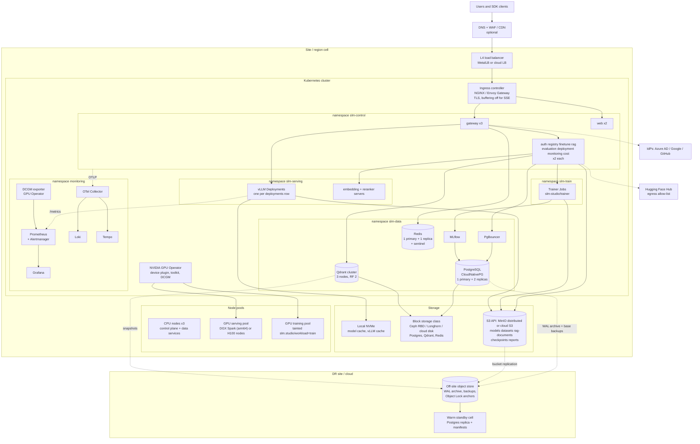

# 06 - Infrastructure

Scope: where SLM Studio runs, how it is connected, how it survives failures and how it is recovered.
Kubernetes and Docker artifacts are covered in [07](07-kubernetes-and-docker.md); the step-by-step install is [09](09-deployment-guide.md).
Status: design; Helm/compose are in progress. Sizing values are **Assumptions** to validate (see [01](01-architecture.md) section 9).

## 1. Deployment topologies

| Topology | Hardware | Orchestration | HA | Use |
|---|---|---|---|---|
| T0 Developer | One laptop / one DGX Spark | `docker compose` (`deploy/compose/`) | None | Local dev; demos |
| T1 Spark single node | 1 DGX Spark (128 GB unified, 1-4 TB NVMe) | k3s single node + Helm chart, or compose | None: node = SPOF. Backups only | Pilot, small team, on-prem edge. Roughly <= 100k req/day of 8B-class traffic |
| T2 Spark pair | 2 DGX Spark linked by ConnectX-7 (direct cable) plus 10GbE to LAN | k3s, 2 servers + external datastore or 1 server + 1 agent | Node-level N+1 for stateless and vLLM replicas; **the datastores (Postgres, MinIO) still need an external HA target or accept RPO of minutes** | Departmental production with modest availability goals |
| T3 H100 cluster | 2+ nodes of 8x H100 (HGX/DGX class) in a datacentre, plus 3 CPU nodes for control plane | Kubernetes 1.30+ (kubeadm/RKE2/AKS/EKS/GKE) | Multi-node, multi-zone | Multi-tenant production |
| T4 Multi-cell | Multiple T3 cells by region | GitOps per cell, global org directory | Regional | Data residency, >1,000 busy orgs |

Assumption A1 (see README): the brief mixes "DGX Spark" and "multi-GPU H100 class". This document gives both; the
chart values and node-pool names are the same, only `nvidia.com/gpu` counts, node selectors and storage classes differ.

Namespace note: the diagram shows the **recommended hardened layout** (separate namespaces for control plane, data services, serving, training, monitoring). The Helm chart's default installs all of its workloads, including platform-managed vLLM servers and trainer Jobs, into one release namespace (`trainer.namespace` can move Jobs), with dependencies in `storage`, `mlops`, `vectordb`, `monitoring`; see [07](07-kubernetes-and-docker.md) section 1. A single namespace is acceptable for T1.

## 2. Infrastructure diagram

## 3. Compute

### 3.1 Node pools

| Pool | Nodes | Spec (Assumption) | Taint / label | Runs |
|---|---|---|---|---|
| `control` | 3 | 8 vCPU, 32 GB RAM, 200 GB SSD, 3 failure domains | `slm.studio/pool=control` | gateway, services, web, ingress, observability |
| `data` | 3 | 16 vCPU, 64 GB RAM, NVMe 1-2 TB | `slm.studio/pool=data` | Postgres, Redis, Qdrant, MLflow, MinIO (if in-cluster) |
| `gpu-serve` | 2+ | DGX Spark (aarch64) or 8x H100 node | `nvidia.com/gpu=present:NoSchedule`, `slm.studio/workload=serve` | vLLM, embedding, reranker |
| `gpu-train` | 0-N | same hardware class; on T1/T2 shares with `gpu-serve` | `slm.studio/workload=train:NoSchedule` | Trainer Jobs |

On T1 (single Spark) all pools collapse onto one machine. Then **cap vLLM at `gpu_memory_utilization <= 0.75` and put Postgres/Redis/Qdrant
under memory limits** (they share the 128 GB with the GPU), and disable training while serving or the OOM killer decides.

### 3.2 GPU specifics

| Topic | DGX Spark (GB10) | H100 node |
|---|---|---|
| Driver | Installed and updated by DGX OS (Ubuntu-based, aarch64). Do **not** install a separate driver. GPU Operator with `driver.enabled=false`; toolkit disabled if NVIDIA Container Toolkit is preinstalled (**verify on your DGX OS release**) | Operator-managed driver container, or host driver pinned per fleet |
| Isolation | One GPU. MIG is not offered on GB10 (**verify**). Time-slicing possible but gives no memory isolation | MIG (up to 7 slices; 1g.10gb on 80 GB parts) for hard isolation of tiny models; MPS or time-slicing for soft sharing |
| Memory | Unified 128 GB shared with OS; `nvidia-smi` memory fields may be N/A (**verify**) | Dedicated 80 GB HBM per GPU |
| Interconnect | ConnectX-7 for node-to-node; no NVLink | NVLink inside the node; IB/RoCE between nodes |
| Parallelism | Single-GPU serving only; 2-node tensor parallel over ConnectX-7 is possible but slow and out of scope | Tensor parallel within a node (NVLink). **SLMs (<= 14B) fit one GPU, so inter-node fabric is not on the serving path**; plain 25-100 GbE is sufficient for serving |
| Images | `linux/arm64`, CUDA 13-era Blackwell build; validate vLLM on GB10 before promising quantisation formats | `linux/amd64`, CUDA 12.x |
| Power and cooling | ~240 W PSU; desk/rack-shelf, ambient air; throttles in hot rooms. Monitor temperature | ~10 kW per 8-GPU node; 2-4 nodes per rack needs 20-40 kW rack power and likely rear-door or liquid cooling |

### 3.3 Autoscaling

- **Pods (vLLM):** HPA/KEDA on `vllm:num_requests_waiting` (queue depth) and KV-cache usage; scale-up fast, scale-down with 10-15 minute stabilisation (each new replica costs a model load, see [01](01-architecture.md) section 9.2). Bounded by `deployments.replicas_min/max`.
- **Nodes:** cluster autoscaler only on cloud targets (`azure`, `aws`); on-prem and Spark are fixed capacity, and the deployment service must refuse a deployment that cannot be scheduled (fit check) rather than leave it `provisioning`.
- **Control plane:** HPA on CPU (gateway also on in-flight requests). PodDisruptionBudgets: `minAvailable: 1` for services with 2 replicas, `maxUnavailable: 1` for gateway x3.

## 4. Network

| Zone | Contents | Rules |
|---|---|---|
| Public | LB, ingress | Only 443 (and 80 redirect). TLS 1.2+ (prefer 1.3), HSTS. WAF/rate limiting at the edge is optional; the gateway enforces per-tenant limits |
| Control | gateway, services, web | Default-deny `NetworkPolicy`; ingress controller to gateway/web only; services accept only from gateway (and from each other where documented: rag->gateway for generation, evaluation->gateway) |
| Data | Postgres, Redis, Qdrant, MinIO, MLflow | Accept only from named app namespaces/labels; no ingress from the internet; trainer pods may reach MinIO, MLflow and `finetune` only |
| Serving | vLLM, embedding, reranker | Accept only from gateway/rag/evaluation; **no egress** except to S3/MinIO for model pulls (and HF Hub through an egress proxy if enabled) |
| Training | Trainer Jobs | Egress allow-list: MinIO, MLflow, `finetune`, optionally HF Hub / W&B. No access to Postgres |
| Observability | Prometheus, Loki, Tempo, Grafana | Grafana behind SSO; Prometheus not exposed |

- **SSE/WebSocket through the ingress:** disable proxy buffering for `/v1/*`, set read timeout >= the longest generation (e.g. 600 s), keep-alive on, HTTP/1.1 or HTTP/2; WebSocket upgrade enabled on `/api/v1/monitoring/stream`.
- **mTLS between services** (service mesh or cert-manager-issued certs) is a Phase 3 hardening item; until then, NetworkPolicies and a trusted cluster network are the control. See [11](11-security-checklist.md).
- **Egress control:** default deny; allow IdP endpoints from `auth`, HF Hub from the model-pull job only. Air-gapped installs mirror HF into `models` and skip egress entirely.
- **DNS:** `api.<domain>` (gateway), `app.<domain>` (web), `grafana.<domain>` (internal). One wildcard or SAN certificate via cert-manager.

## 5. Storage

| Data | Store | Class / config | Durability |
|---|---|---|---|
| Model weights (hot cache) | Local NVMe on GPU nodes, `emptyDir` or hostPath cache at `/models` | Read-through from S3 `models` on first start | Cache: loss is a re-download |
| Model artifacts, datasets, RAG source docs, checkpoints, reports | S3 API: cloud S3/Blob or MinIO distributed (erasure coding, >= 4 drives/nodes) | Versioning on `models`, `datasets`; Object Lock (compliance mode) on `reports/anchors/`; lifecycle rules per [02](02-database-schema.md) section 6; SSE-KMS/SSE-S3 | EC 4+2 survives 2 drive losses. **Single-drive MinIO on one Spark has no redundancy**: back it up |
| PostgreSQL | CloudNativePG cluster: 1 primary + 2 replicas (1 synchronous), block storage with `fsync` honoured, `wal_level=replica`, PgBouncer transaction pooling | 100-500 GB initially; `usage_logs` monthly partitions dominate growth (~100 GB/month at 10M req/day) | See DR |
| Vector DB | Qdrant: 3 nodes, replication factor 2, WAL + snapshots; payload index on `org_id`, `index_id` | NVMe for vectors/HNSW; RAM sized at ~1.2 x (vectors x dim x bytes) for in-memory vectors, or on-disk + quantisation | Rebuildable from `rag-documents` (source of truth) |
| Redis | Primary + replica + Sentinel; AOF off (cache + counters; losing it only resets rate windows) | 2-8 GB | Not durable by design |
| MLflow | Backend store in PostgreSQL (separate database), artifacts in S3 | | With Postgres |
| Logs / traces / metrics | Loki + Tempo on S3; Prometheus local TSDB 15 d + optional remote write | Retention table in [12](12-monitoring-design.md) | |

Qdrant RAM math (example): 5 M chunks x 1024 dim x 4 B (float32) = 20.5 GB vectors; with scalar int8 quantisation 5.1 GB in RAM
and full-precision vectors on disk; HNSW graph (m=16) adds roughly 5-10% depending on config. Plan 1.3x as headroom (Assumption).

## 6. High availability

### 6.1 Per-component HA

| Component | Replicas / spread | Failure behaviour | Target |
|---|---|---|---|
| Ingress | 2-3, anti-affinity across nodes/zones | LB health checks drop a failed node | no impact |
| gateway | 3, topology spread across zones | HPA; rolling update `maxUnavailable: 0` | no impact |
| Other services | 2 each, anti-affinity | Stateless; PDB protects drains | no impact |
| vLLM per deployment | `replicas_min >= 2` for production aliases, on different nodes | Gateway retries pre-first-byte on another replica; in-flight streams on the dead replica are lost | Interrupted streams only |
| Postgres | CNPG 1+2, sync replica for zero data loss on single failure, automated failover (~10-30 s) | Control plane 503 during failover; inference continues on cached keys/routes | RPO 0 (sync), RTO < 2 min |
| Redis | primary + replica + Sentinel | Failover ~15 s; gateway degrades to DB lookups | |
| Qdrant | RF 2 of 3 nodes | Reads served by replica | |
| MinIO | EC across >= 4 nodes/drives | Tolerates drive/node loss within parity | |
| Prometheus | 2 replicas (HA pair) or Thanos/remote-write | Alerting must not be a single pod | |

### 6.2 Failure-domain rules

- Spread control and data pods across **zones** (cloud) or **racks/hosts** (on-prem): `topologySpreadConstraints` with `maxSkew: 1`.
- Postgres sync replica in a different failure domain from the primary.
- **T1 and T2 have shared-fate**: a single Spark's loss = full outage including Postgres. T2 improves vLLM availability only. Customers needing real HA on Spark hardware must put Postgres and object storage on an external HA service.
- Planned maintenance: drain one GPU node at a time; vLLM replicas >= 2 per production alias makes this non-disruptive. With one replica, a rollout is an outage; the deployment service's `blue_green` strategy starts the new pods first, but needs enough free GPU memory for both: **on a single Spark this usually means stop-then-start**, which should be surfaced to the user, not hidden.

## 7. Disaster recovery and backup

Definitions: RPO = tolerable data loss; RTO = tolerable downtime. Targets are **Assumptions** to be agreed with the business.

| Tier | RPO | RTO | Mechanism |
|---|---|---|---|
| T1/T2 (Spark) | 24 h (nightly backup) or 5 min with WAL shipping | 4-8 h manual rebuild | Off-box backups to NAS/S3, documented rebuild from bare metal ([09](09-deployment-guide.md)) |
| T3 (H100, single region) | <= 5 min | <= 1 h | PITR restore; GitOps re-apply |
| T3 + DR site | <= 5 min (async WAL) | <= 1-4 h | Warm standby: replica Postgres in DR cluster, replicated buckets, manifests pre-staged, DNS cutover |

### 7.1 What is backed up and how

| Asset | Method | Frequency | Retention | Restore test |
|---|---|---|---|---|
| PostgreSQL (all app data, MLflow DB) | Continuous WAL archiving + base backups (pgBackRest, or CNPG with Barman Cloud) to off-site S3, encrypted, `archive_timeout = 60 s` | WAL continuous; base backup daily | 35 days PITR window; monthly base backups 13 months | Quarterly: restore to scratch cluster, run migration check + RLS test suite + audit hash-chain verification |
| Object storage | Versioning + cross-site bucket replication (async) | continuous | `models`/`datasets`: versions 30 d; `reports`: per lifecycle; Object Lock on `reports/anchors/` | Quarterly: restore a model version and a dataset, hash-compare against `artifact_sha256` |
| Qdrant | Snapshots to S3 per collection daily; **fallback is re-ingest from `rag-documents`** | daily | 7 days | Semiannual: restore one collection, compare chunk counts with `rag_indexes.chunk_count` |
| Cluster state | GitOps: Helm values and manifests in Git are the source of truth. k3s: etcd/SQLite snapshots every 6 h | per change / 6 h | 14 days | Rebuild a cluster from Git in a game day |
| Secrets | External secret manager (Vault / cloud KMS) or sealed-secrets with offline-escrowed key; **never only in-cluster** | per change | | Verified by rebuild |
| Model weights from HF | Pinned revision hashes; mirrored copy in `models` bucket | on import | with versions | |
| Redis | Not backed up | - | - | After a Redis loss all rate-limit windows reset: acceptable |
| Grafana dashboards | Provisioned from `deploy/grafana/` | per change | Git | |

### 7.2 Recovery runbooks (to exist before go-live; see [10](10-production-checklist.md))

1. **Postgres primary loss, replica healthy**: automatic failover; verify replication re-established; no data loss with sync replica.
2. **Postgres total loss**: restore latest base backup + WAL to target time; run `db/migrate.py` (no-op if current); verify RLS tests and `usage_logs_default` empty; point services via secret rotation; flush Redis key cache.
3. **Region loss**: promote DR Postgres replica; scale DR GPU pool; restore Qdrant from snapshots or start re-ingest (hours for large indexes, so prioritise indexes by tenant tier); cut DNS (TTL <= 60 s pre-staged).
4. **Ransomware / destructive admin action**: Object Lock and off-site backups are the defence; restore into a new cluster, never in place; verify audit hash chain against external anchors to detect tampering.
5. **GPU node loss**: vLLM replicas reschedule if capacity exists; otherwise the alias returns `no_healthy_deployment` (503) until capacity is restored; alert `NoHealthyRoute` ([12](12-monitoring-design.md)).

## 8. Capacity and cost levers

| Lever | Effect |
|---|---|
| Quantise to FP8 / AWQ-int4 | 2x / 3-4x smaller weights: more KV room on H100, **more tokens/s on Spark** (bandwidth-bound) |
| Prefix caching (`enable_prefix_caching`) | Large saving for RAG/system-prompt-heavy traffic; hit rate metric in [12](12-monitoring-design.md) |
| Speculative decoding | Lower latency at low batch; gains shrink as batch grows |
| LoRA multiplexing | Many tenants' fine-tunes on one base deployment |
| MIG on H100 | Hard-isolated slices for very small models; wasteful for 8B+ |
| Scale-to-zero (`replicas_min = 0`) | Dev/test only (cold start seconds to minutes) |
| Reserved vs on-demand (cloud targets) | Cost model in [13](13-cost-estimation.md) |
