# 08 - CI/CD

Platform: GitHub Actions (`.github/workflows/`), images in GHCR (or the customer's registry), Helm deployment with environment approvals, optional GitOps pull
(Argo CD or Flux) or a self-hosted runner for on-prem targets.

Status (reviewed 2026-10-14): four workflows plus Dependabot exist and are described in section 2.1 as **observed**; they have not been run by the authors of this
documentation. The remainder of this page is the target pipeline and the gate list a reviewer should hold the workflows to; section 3.1 lists which gates are not yet implemented.

## 1. Pipeline overview

```mermaid
flowchart LR
    pr["Pull request"] --> fast["Fast checks<br/>lint, types, unit tests,<br/>openapi + docs checks"]
    fast --> db["DB tests<br/>real PostgreSQL, RLS suite,<br/>migration apply + checksum"]
    db --> build["Build images<br/>amd64 + arm64"]
    build --> scan["Scan + SBOM<br/>Trivy, Syft"]
    scan --> integ["Integration<br/>compose stack + mock vLLM"]
    integ --> merge["Merge to main"]
    merge --> push["Push images by digest<br/>sign with cosign"]
    push --> stg["Deploy to staging<br/>helm upgrade (migrate hook)"]
    stg --> smoke["Smoke + e2e<br/>/readyz, curl, OpenAI SDK, Playwright"]
    smoke --> gate{"Manual approval<br/>release tag vX.Y.Z"}
    gate --> prod["Deploy to prod<br/>canary then full"]
    prod --> verify["Post-deploy SLO check<br/>auto-rollback on burn"]
    nightly["Nightly on DGX Spark runner<br/>vLLM + trainer GPU smoke,<br/>perf regression"] --> stg
```

## 2. Workflows

### 2.1 Observed in `.github/workflows/`

| File | Trigger | What it does |
|---|---|---|
| `ci.yml` (CI) | PR, push, manual | `python`: matrix 3.11 and 3.12, Postgres 16.6 and Redis 7.4 service containers, `uv lock --check`, `uv sync --frozen --all-packages`, `ruff check`, `ruff format --check` (3.12), applies migrations with `db/migrate.py --dsn <admin> --app-password ...` (creates `slm_app`), `pytest`. `web`: lint, typecheck, test, build. `helm`: lint, template with `ci/values-*.yaml`, kubeconform, uploads rendered manifests. `compose`: `docker compose config`. `hadolint`. `docker-build`: smoke build per image. `trivy-fs`: filesystem scan. `gitleaks`: full-history secret scan. `ci-ok`: aggregate required check |
| `build-push.yml` (Build and Push) | push to main, manual | Matrix over the nine service images, `web`, `web-staging` and `trainer`, all `linux/amd64,linux/arm64` via QEMU + buildx; pushes to GHCR; Trivy image scan; SBOM (anchore/sbom-action); keyless cosign signing (OIDC) |
| `deploy.yml` (Deploy) + `_deploy-env.yml` | after a successful Build and Push on main, or manual dispatch with `image_tag` and `environment` | Resolves the version, then per environment: cosign signature verification, `helm upgrade --install --atomic` (migration hook first), smoke test (`deploy/scripts/smoke-test.sh`: `/readyz`, `/v1/models`), automatic rollback to the previous revision on failure. Staging deploys automatically; production waits for the approval configured on the `production` GitHub Environment |
| `.github/dependabot.yml` | schedule | Dependency and base-image update PRs |

### 2.2 Proposed additions

| Workflow or job | Purpose |
|---|---|
| `openapi` job in `ci.yml` | `openapi-spec-validator` on `docs/openapi/*.yaml`, breaking-change diff against main, contract tests running the spec examples against the gateway |
| `rls` job (or a named pytest marker) | The tenant-isolation suite as a separate, always-required check (see gate table) |
| `docs` job | Markdown link check and mermaid parse (the docs in this repository were checked with a mermaid parser and a link/anchor script) |
| `security.yml` | CodeQL for Python and TypeScript, `pip-audit` and `npm audit --omit=dev`, license check |
| `nightly-gpu.yml` | Self-hosted DGX Spark runner (arm64 + GPU): start the pinned vLLM image with a small model, inference smoke suite, a 50-step QLoRA trainer smoke, perf-regression benchmark |
| `release.yml` | Tag `v*`: retag the digest set, changelog, GitOps promotion PR, SBOM bundle, offline bundle for air-gapped sites |

## 3. Quality gates

A change merges only if all of these pass. "Blocking" gates have no manual override except by a repository admin with a recorded reason.

| Gate | Tooling | Blocking | Notes |
|---|---|---|---|
| Lint and format | `ruff check`, `ruff format --check` (config in root `pyproject.toml`: rule sets E, F, I, UP, B, ASYNC, S, RUF) | Yes | `S` rules double as basic SAST |
| Python unit tests | `uv run pytest` (`testpaths = services`, asyncio auto) with coverage; threshold 80% for `slm_common`, `gateway`, `auth`, `registry`; ratcheting for others | Yes | |
| **Tenant-isolation tests** | pytest against a real PostgreSQL (the repo's dev dependency `pgserver` embeds one) connecting as the non-owner `slm_app` role: for every table with `org_id`, prove cross-tenant SELECT/INSERT/UPDATE/DELETE are denied; assert RLS enabled+forced; assert no new public table lacks an allow-listed policy | Yes | The most important test in the repo |
| Migration check | Apply all migrations to an empty DB; re-apply -> no-op; checksum of already-applied files unchanged; apply `N-1` schema + `N` code (expand/contract compatibility test) | Yes | See [02](02-database-schema.md) section 8 |
| OpenAPI | `openapi-spec-validator` on `docs/openapi/*.yaml`; oasdiff breaking-change check vs main; generated TypeScript types in `web/lib/api/types.ts` and pydantic schemas compared to the YAML (contract tests) | Yes | |
| Web | `next lint --max-warnings 0`, `tsc --noEmit`, `vitest run`, `next build` | Yes | Scripts exist in `web/package.json` |
| Docs | Markdown link check; mermaid blocks parsed (`mermaid-cli` / `@mermaid-js/parser`); docs that cite `CONTRACT.md` table/column names are checked against `0001_init.sql` identifiers by a small script (**Proposed**) | Yes for links and mermaid; warning for identifier drift | |
| Helm | `helm lint`, `helm template` for each values file, `kubeconform` strict, `kube-linter` or `kubescape` policy pass | Yes | |
| Secret scan | gitleaks on the diff and full history weekly | Yes | |
| Dependency/CVE | pip-audit, npm audit (prod deps), Trivy on images: fail on fixable CRITICAL; HIGH needs a waiver with expiry | Yes (critical) | |
| Image policy | Non-root, no `latest`, read-only rootfs compatible, digest-pinned base | Yes | Conftest/OPA or Trivy config |
| Integration | `docker compose` dev stack with a mock OpenAI-compatible upstream: register -> login -> create key -> `/v1/chat/completions` (stream and non-stream) -> usage row exists -> rate limit 429 | Yes | |
| E2E UI | Playwright against the compose stack | Yes on main, advisory on PR | |
| Load/perf | k6 or vLLM `benchmark_serving`-style script on nightly Spark runner; fail on > 15% regression of TTFT p95 or tokens/s vs the rolling baseline | Nightly, not PR | Results need baseline per hardware tier |

### 3.1 Gate status against the observed workflows

| Gate | State |
|---|---|
| Lint and format (ruff), Python tests, lockfile check | Implemented (`ci.yml`) |
| Web lint, typecheck, tests, build | Implemented |
| Helm lint, template, kubeconform; compose config; hadolint; docker build smoke | Implemented |
| Secret scan (gitleaks), filesystem scan (Trivy), image scan, SBOM, signing and signature verification at deploy | Implemented |
| Migrations applied in CI | Implemented (applies to an empty DB as admin; `db/migrate.py` takes an advisory lock and records checksums in `schema_migrations`); **not yet asserted in CI**: re-apply is a no-op, a changed checksum of an applied file fails, N-1 schema with N code |
| Tenant-isolation tests | Partly implemented: `services/common/tests/test_db_audit.py` covers tenant isolation, no context leakage across pooled connections, global-catalogue read-only, `slm_app` not superuser/`BYPASSRLS`, and the audit chain/append-only trigger; auth, registry and gateway tests add resource-level checks. **Missing:** a generic test that enumerates every table with `org_id` and proves cross-tenant SELECT/INSERT/UPDATE/DELETE fail, and API-level 404 tests for every resource type |
| OpenAPI validation, breaking-change diff, generated types | Not implemented |
| Docs checks (links, mermaid, identifier drift) | Not implemented |
| CodeQL / dependency CVE audit jobs | Not implemented (Dependabot and Trivy partially cover) |
| Image policy (non-root, no `latest`): partly covered by hadolint | Partial |
| Load/perf and GPU smoke on real arm64 + GPU | Not implemented (arm64 images are built under QEMU only) |
| Playwright e2e | Not implemented |

## 4. Build details

- **Multi-arch**: `docker buildx build --platform linux/amd64,linux/arm64`. Use native arm64 runners where available; QEMU emulation of arm64 is slow for Python wheels but acceptable for pure-Python service images. The trainer and vLLM-wrapper images **must be built and tested on real arm64+Blackwell hardware** (the nightly Spark runner), not emulated.
- **Caching**: uv cache keyed on `uv.lock`; buildx registry cache; npm cache on `package-lock.json`.
- **Reproducibility**: `uv sync --frozen`; base images pinned by digest and updated by a bot PR (Renovate/Dependabot) so upgrades are reviewed.
- **Provenance**: SLSA-style build provenance attestation; images signed keyless with cosign via GitHub OIDC; admission policy in the cluster (Kyverno/Sigstore policy-controller) verifies signatures in production namespaces (Phase 3).
- **SBOM**: Syft (SPDX/CycloneDX), attached to the image as an attestation.
- **Path filters** so a docs-only change does not build GPU images; but `docs/openapi/**` and `db/migrations/**` always trigger contract/db jobs.

## 5. Environments, promotion and rollback

| Environment | Trigger | Approval | Data |
|---|---|---|---|
| dev (per-PR, optional) | PR label | none | Synthetic; ephemeral namespace or compose |
| staging | every merge to main | none | Synthetic/scrubbed |
| prod | release tag `vX.Y.Z` | Required reviewers (2) via GitHub Environments | Real |

- **Promotion is by immutable image digest + values commit**, never by rebuilding. The tag only names a set of digests.
- **Order of operations on deploy**: (1) pre-upgrade Helm hook runs migrations (backward compatible with the old code); (2) services roll with `maxUnavailable: 0`; (3) smoke; (4) canary: first the gateway at ~10% of replicas for 10-15 minutes watching error rate and latency SLOs ([12](12-monitoring-design.md)); (5) full roll.
- **Rollback**: `helm rollback` / GitOps revert restores previous digests. Migrations are forward-only, so rollbacks rely on expand/contract (old code runs on the new schema). A migration that violates this is not allowed to merge (CI compatibility test). Data-destructive migrations (drop column) ship one release after the code stops using it.
- **Model-serving deployments are not part of this pipeline**: they are customer actions through the API. Platform releases must not restart tenant vLLM pods unless the vLLM image version changes; changing it is a separate, announced rollout ([14](14-roadmap.md)).
- **On-prem / Spark targets** are usually not reachable from GitHub-hosted runners. Use a pull model (Flux/Argo agent in the cluster watching the GitOps repo) or a self-hosted runner on the Spark. Air-gapped sites receive an offline bundle (images as OCI tarballs + chart + SBOM) produced by `release.yml`.

## 6. Secrets and access in CI

- GitHub OIDC to the cloud/registry (no long-lived cloud keys); registry write only from `main`/tag workflows.
- `pull_request` workflows from forks get no secrets. Use `pull_request_target` only for labelling, never for checking out untrusted code.
- Environment-scoped secrets for staging/prod; prod secrets live in the external secret manager and are not in GitHub at all.
- Actions pinned by commit SHA; `permissions:` set to minimum per job (`contents: read`; `id-token: write` only on signing jobs; `packages: write` only on push).
- Branch protection on `main`: required checks, linear history, signed commits recommended, CODEOWNERS for `db/migrations/`, `services/common/`, `deploy/`, `docs/openapi/`, and `CONTRACT.md`.

## 7. Definition of done for a service change

1. Contract (`CONTRACT.md`, OpenAPI, migration) updated first if the change touches it.
2. Unit tests plus a tenant-isolation test for any new tenant table or query.
3. Metrics, logs and traces use the shared helpers; new alertable behaviour has an alert rule or a stated reason not to.
4. Docs in `docs/` updated in the same PR (the docs job enforces link/mermaid validity only; humans enforce truth).
5. Rollout and rollback considered and written in the PR description if the change is not trivially reversible.
