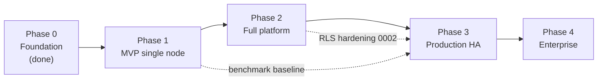

# 14 - Roadmap, Risks, Open Questions and Licence Caveats

No dates are promised: effort is sized relatively (S/M/L/XL) and exit criteria are testable statements. Status is as of 2026-10-14 and is deliberately blunt.

## 1. Current status

| Area | State | Detail |
|---|---|---|
| Contract and schema | Done | `CONTRACT.md`, `db/migrations/0001_init.sql` (RLS on tenant tables, partitioned `usage_logs`, append-only `audit_logs`, seeded global catalogue). Known hardening gaps listed in [02](02-database-schema.md#schema-gaps-and-follow-up-migrations) |
| `slm_common` | Implemented | Public API per contract section 3 |
| auth service (:8001) | Implemented | Register/login/refresh/logout, OAuth providers, orgs/members/projects/API keys |
| registry service (:8002) | Implemented | Models, versions, rollback, benchmark scores |
| gateway (:8000) | Implemented | `/v1/*` proxy with SSE passthrough, key auth, quotas/limits, routing, usage logging, `/api/v1/*` reverse proxy |
| finetune (:8003), rag (:8004), evaluation (:8005), deployment (:8006), monitoring (:8007), cost (:8008) | **Typed stubs** with a few real utilities | Models and route signatures exist; no Kubernetes orchestration, no training launch, no ingestion/retrieval, no judge-based evaluation, no metric/cost roll-ups |
| Web UI | In progress | Next.js 15 scaffold with shadcn/ui primitives, typed API client, mock layer; pages per [04](04-frontend-wireframes.md) not complete |
| Docker, Compose, Helm, k8s manifests, Grafana dashboards | In progress | Layout in [07](07-kubernetes-and-docker.md) |
| CI workflows | In progress | Gates in [08](08-cicd.md) |
| Trainer image, vector DB adapters, MLflow wiring | Not started | Designed in [15](15-mlops-and-rag.md) |
| Measured performance baseline | Not started | All capacity/cost numbers are modelled ([01](01-architecture.md) s9, [13](13-cost-estimation.md)) |
| Security hardening items (RLS bypass redesign, audit anchoring, mTLS, pen test) | Not started | [11](11-security-checklist.md) |

What works end to end today, in principle: a user can register, create an org/project/API key, register models and versions, and an OpenAI client can call the gateway **if** a vLLM server
is started by hand and registered in `deployments`/`endpoint_routes`. What does not: any self-service flow that requires the stub services.

## 2. Phases

### Phase 0: Foundation (done)

Contract, schema, shared library, auth, registry, gateway. Exit criteria met: services start, tests run against a real PostgreSQL, OpenAI-shaped and problem+json errors implemented.

### Phase 1: MVP on one DGX Spark (size L)

Goal: the [09 deployment guide](09-deployment-guide.md) works without manual fallbacks, and a team can use it for real.

| Work item | Notes |
|---|---|
| Deployment service: render and apply vLLM `Deployment`/`Service` from a `deployments` row, state machine, readiness, endpoint routing (direct strategy), stop/start/scale, reconcile loop, fit check | [07](07-kubernetes-and-docker.md) s1, s6 |
| Web UI core: login/register, overview, API keys, models, deployments, endpoints, playground (streaming), members/projects, audit log | [04](04-frontend-wireframes.md) |
| Docker images (multi-arch), compose (dev + spark), Helm chart with migration hook, GPU test | |
| CI: lint, tests, RLS suite, migrations, OpenAPI validation, image build + scan, compose integration test | [08](08-cicd.md) |
| Monitoring minimum: vLLM + DCGM + gateway metrics, Grafana dashboards 5.1-5.3, alerts for `NoHealthyRoute`, `UsageRowsDropped`, `NodeMemoryLow`, Postgres | [12](12-monitoring-design.md) |
| Partition maintenance for `usage_logs` (monitoring service) | Else rows go to the default partition |
| Benchmark harness and **measured** throughput/latency baseline on Spark (and on H100 if available); update [01](01-architecture.md) and [13](13-cost-estimation.md) tables | Production checklist C1 |
| Backup of Postgres + buckets with one tested restore | D1, D2 |
| Decisions: OQ-1, OQ-2, OQ-4, OQ-5, OQ-12 | section 4 |

**Exit criteria**

1. Fresh DGX Spark to first successful streaming completion via the OpenAI SDK following [09](09-deployment-guide.md) verbatim, no manual SQL except bootstrap steps.
2. Cross-tenant isolation test suite green in CI (T1 in the checklist), including API-level 404 tests.
3. Measured p95 TTFT and tokens/s for one 8B-class model at 1, 8, 32 concurrent streams, committed to `docs/` replacing modelled values.
4. A restored backup passes the RLS suite and audit-chain check.
5. Usage rows exist for 100% of successful requests in a 1-hour soak (S7).

### Phase 2: Full platform (size XL)

| Work item | Notes |
|---|---|
| Fine-tuning: dataset validation/upload, trainer image (Unsloth + PEFT + TRL, QLoRA/LoRA), Kubernetes Job lifecycle, metrics callback, checkpoints, output registered as `model_versions` (lineage), cancel, cost estimate; MLflow tracking | [15](15-mlops-and-rag.md) s1-s4; separate arm64 and amd64 trainer builds |
| Evaluation: metric implementations (accuracy, F1, ROUGE, BLEU, JSON validity, toxicity), LLM-as-judge (faithfulness, groundedness, hallucination), comparison, latency/cost columns, bootstrap CIs | [15](15-mlops-and-rag.md) s8 |
| RAG: Qdrant integration, ingestion workers (parse, chunk, embed, upsert), hybrid search + reranker, query API with citations, per-tenant filter tests | [15](15-mlops-and-rag.md) s5-s7 |
| Deployment: blue/green and canary strategies, A/B routing UI, rollback | |
| Cost service: daily roll-up, summaries, CSV; rate card management; budget alerts | [13](13-cost-estimation.md) |
| Monitoring service: overview and per-deployment APIs from `usage_logs` + Prometheus; WebSocket stream | |
| Migration `0002` (security and schema hardening): remove GUC-bypass dependence, composite FKs, audit insert policy and TRUNCATE guard, indexes, CHECKs, `org_sso_configs`, `org_invitations`, notification tables, `datasets.sha256`, cost key/rates fixes | [02](02-database-schema.md) gaps 1-11 |
| Org-level SSO (OIDC/SAML), MFA enrolment, password reset, email verification, quota and org settings APIs | |
| Audit chain verification job + external anchoring | |
| Security testing: log-scrubbing test, safe-model-format enforcement (reject pickle), sandboxed parsing | [11](11-security-checklist.md) DH5-DH8 |

**Exit criteria**

1. A tenant can: upload a dataset, fine-tune a model, evaluate it against the base, deploy it as canary at 5%, promote it, and roll back, entirely through UI/API, with correct lineage and audit entries.
2. RAG: ingest 10k documents, hybrid query p95 < 1 s excluding generation (**Assumption**), zero cross-tenant results in an adversarial test with two tenants and identical documents.
3. Evaluation judged metrics agree with a human-labelled set of >= 200 items at Cohen's kappa >= 0.6 (see [15](15-mlops-and-rag.md) s8.4), or the metric is flagged "indicative".
4. Cost roll-up reconciles with `usage_logs` within 0.5% and with measured GPU-hours within 2%.
5. `0002` applied; RLS tests include the FK-oracle and bypass-role tests.

### Phase 3: Production HA (size XL)

| Work item | Notes |
|---|---|
| T3 reference deployment: multi-node H100 Kubernetes, multi-zone, GPU Operator-managed, node pools, HPA/KEDA on vLLM queue/KV metrics | [06](06-infrastructure.md) |
| HA datastores: CNPG 1+2 with sync replica, Redis Sentinel, Qdrant 3-node RF 2, MinIO/S3 with erasure coding | |
| mTLS between services; admission policy verifying image signatures; Pod Security enforcement | [11](11-security-checklist.md) |
| DR: off-site WAL archive, warm standby, game day; restore drills scheduled | |
| SLOs live with burn-rate alerting and error-budget policy | [12](12-monitoring-design.md) s3 |
| Multi-LoRA serving productised (adapter load/unload, routing by alias) | OQ-3 |
| Per-org concurrency caps, priority scheduling, noisy-neighbour tests | |
| Third-party penetration test and remediation; SOC 2 readiness gap assessment (if required) | |
| Load tests at target scale (10M req/day equivalent), 24 h soak | Production checklist C2 |

**Exit criteria**: all P0 rows of [10](10-production-checklist.md) have evidence; chaos tests for Redis, Postgres failover, GPU node loss and vLLM crash pass; error-budget burn alerts fire correctly in a fault-injection drill; pen test has no open high/critical findings.

### Phase 4: Enterprise (size XL, ongoing)

Cells and regions (org-to-cell directory, per-cell data residency), per-org customer-managed encryption keys, private connectivity (PrivateLink/peering), invoice/billing system integration and price plans (markup and negotiated rates), content-safety guardrails and PII redaction as optional pipeline stages, batch/async inference API tier (raises utilisation, cuts cost), hyperparameter sweeps, distillation workflows, model marketplace with licence click-through, SCIM provisioning, advanced audit export (SIEM connectors), compliance attestations (SOC 2 Type II, ISO 27001) if the business requires them.
**Exit criteria**: a customer in a second region can be onboarded with data residency proven by network and storage tests; CMK revocation renders that tenant's data unreadable within the documented time.

## 3. Risks

| # | Risk | Likelihood | Impact | Mitigation |
|---|---|---|---|---|
| R1 | vLLM, PyTorch, Unsloth or CUDA support for GB10 (`sm_121`, aarch64) lags or is unstable; some quantisation formats unavailable on Spark | High | High for Tier S | Pin NVIDIA-validated containers, nightly GPU smoke job on real Spark ([08](08-cicd.md)), keep a tested "known good" matrix, document unsupported formats |
| R2 | Spark memory bandwidth (273 GB/s) limits throughput far below datacentre expectations; customers expect H100-like speed | High | Medium | State capacity honestly ([01](01-architecture.md) s9); scope Tier S to dev/edge/small teams; measure and publish |
| R3 | Brief ambiguity: DGX Spark vs multi-GPU H100 (A1) leads to building for the wrong tier | Medium | High | Decide OQ-2 at Phase 1 start; both tiers share code, only values differ |
| R4 | Unified memory on Spark: training and serving contend; OOM kills; page-cache pressure | High | Medium | Memory budgets in the deployment service, `NodeMemoryLow` alert, no co-scheduling of training with serving without explicit override |
| R5 | RLS bypass is a settable GUC; a SQL injection or compromised service defeats tenancy | Medium | Critical | `0002` role-based bypass, code review of dynamic SQL, DB-level tests |
| R6 | Cross-tenant FK references and missed `tenant_tx` usage | Medium | High | Composite FKs, lint/test enumerating DB access paths |
| R7 | Model licence non-compliance (Llama/Gemma terms, gated downloads, derivative naming) | Medium | High (legal) | Section 5, licence register, click-through acceptance, restrict weight export |
| R8 | Fine-tuning data leakage across tenants or into logs/telemetry | Low | Critical | DH1-DH4 tests; scoped credentials; log-scrubbing CI job |
| R9 | Unsafe model/dataset artifacts (pickle execution, parser exploits) | Medium | High | Safetensors-only policy, sandboxed parsing, no egress |
| R10 | MinIO community edition distribution/maintenance changes | Medium | Medium | Services use only the S3 API; keep an alternative store qualified (SeaweedFS/Garage/Ceph RGW) |
| R11 | LLM-as-judge metrics are biased/noisy and customers treat them as ground truth | High | Medium | Calibration against human labels, bootstrap CIs, judge != candidate warning, "indicative" labelling ([15](15-mlops-and-rag.md)) |
| R12 | Cost model mispricing from modelled throughput and optimistic utilisation | High | Medium | Replace with measured values, show both unit and fleet views ([13](13-cost-estimation.md)) |
| R13 | Single-node T1 mistaken for production-grade HA | Medium | High | Say so in install docs and UI; refuse `replicas_min >= 2` claims on a single node |
| R14 | Scope: nine services plus UI plus infra for a small team | High | High | Phase gates; cut order if needed: evaluation judge metrics, canary strategies, then RAG hybrid features |
| R15 | Key cache TTL (60 s) delays revocation of leaked keys | Medium | Medium | Push invalidation (K4) |
| R16 | Tenant noisy-neighbour effects on shared batching | Medium | Medium | Per-org concurrency caps, `max_num_seqs`, priority scheduling, separate pools |
| R17 | vLLM metric/flag churn breaks dashboards or deployment rendering on upgrade | High | Low-Medium | Pin versions, per-version flag/metric tables, container-start smoke test in CI |

## 4. Open questions (decisions needed)

| ID | Question | Why it matters | Proposed answer | Owner |
|---|---|---|---|---|
| OQ-1 | The implemented gateway uses `bypass=True` for key lookup, route resolution and usage inserts. Replace with narrow `SECURITY DEFINER` functions? | Bypass scope on the internet-facing service | `resolve_api_key(hash)` returning minimal columns, plus route-resolve and usage-insert functions; gateway role without general bypass | Security + gateway owner |
| OQ-2 | Is the production target DGX Spark, H100-class, or both (A1)? | Sizing, HA, cost, images | Both tiers; Spark = dev/edge/small team, H100 = shared multi-tenant production | Product |
| OQ-3 | How does a route target an adapter inside a LoRA-enabled deployment, and how does the gateway rewrite `model`? | Multi-tenant fine-tune serving at scale | Adapter name from `vllm_args.lora_modules`; route carries the adapter name (new column or `label` convention) | Deployment owner |
| OQ-4 | How does the web playground authenticate to `/v1/*` (API keys only per contract)? | UX and security | Short-lived project-scoped key minted per session, audited, auto-revoked | Gateway + web |
| OQ-5 | Semantics of `endpoint_kind` (`private`/`shared`/`dedicated`) and which one the cost model bills how | Pricing and scheduling | As defined in [01](01-architecture.md) s8 | Product |
| OQ-6 | Is the audit hash chain computed in `slm_common.audit` (app) or by trigger; who anchors it externally? | Tamper-evidence claim | App-side computation under advisory lock + daily external anchor | Security |
| OQ-7 | Do `cost_rates` hold cost or price? Per-org negotiated rates? | Chargeback vs billing | Cost-basis now; add markup/plan table in `0002` | Finance + product |
| OQ-8 | Which S3-compatible store is the supported default given MinIO's status? | On-prem install | Keep MinIO as documented default, qualify one alternative | Platform |
| OQ-9 | Redis outage policy for limits: fail open or closed? | Availability vs abuse | Implemented: fail open to per-replica in-process limits (`ResilientStore`); confirm and decide whether to lower per-replica caps while degraded | SRE + security |
| OQ-10 | Residency: cells in one control plane, or fully separate installs per region? | Operational complexity | Separate cells with a thin org directory | Architecture |
| OQ-11 | Error codes and rate-limit headers were reconciled with the gateway source on 2026-10-14 ([03](03-api-spec.md) s2.5); remaining unverified: route resolution order (own alias vs shared), upstream error passthrough shapes for vLLM 4xx | Client compatibility | Add contract tests that run the OpenAPI examples against the gateway in CI | Gateway owner |
| OQ-12 | `api_keys.key_hash` comment says `sha256(secret)`, contract says `sha256(full key)`; `prefix` comment shows `slm_a1b2` (8 chars incl. `slm_`) while the key format has an 8-char prefix after `slm_` | Interop and key lookup correctness | Contract wins: hash the full key string; clarify `prefix` semantics; fix the SQL comment in `0002` | Auth owner |
| OQ-13 | Who may set `is_platform_admin`, and how is the first one created? | Bootstrap security | Operator SQL / CLI only, MFA enforced | Security |
| OQ-14 | Does model-weight download exist as a feature? | Licence flow-down, exfiltration | No download for restricted-licence models; adapters downloadable only after licence acceptance | Legal + product |
| OQ-15 | Should a failed training Job be retried automatically? The chart sets `trainer.backoffLimit: 2` | Retries re-run an expensive GPU job; OOM or bad-data failures will not heal by retrying | `backoffLimit: 0` plus explicit user or policy retry with resume-from-checkpoint | Finetune owner |

## 5. Model licence caveats

The platform calls the models "open-weight". **Several seeded catalogue models are not open source in the OSI sense.** The seed rows in `0001_init.sql` record a one-word `license` label; that is not a substitute for reading the licence of the exact version you deploy (licences change between releases; this table reflects the licences as understood at writing and must be re-verified before shipping).

| Model (seed name) | Licence | OSI-approved open source? | Key obligations and restrictions | Platform handling |
|---|---|---|---|---|
| `phi-4` (14B), `phi-4-mini` (3.8B) | MIT | Yes | Retain copyright and licence notice | Lowest-friction defaults for demos and the first-run guide |
| `llama-3.1-8b` | Llama 3.1 Community License (custom) | **No** | Gated download (accept terms on Hugging Face); "Built with Llama" attribution; derivative models distributed must carry a "Llama"-prefixed name; separate licence needed above a monthly-active-users threshold (700 M for the 3.x licences); Acceptable Use Policy flows down to users; version 3.1 allows using outputs to improve other models, earlier Llama licences did not | Licence badge in UI; click-through acceptance per org; copy licence to fine-tuned `models` rows; restrict weight export; include AUP in customer terms |
| `gemma-3-4b` | Gemma Terms of Use (custom) | **No** | Gated download; Prohibited Use Policy flows down; terms must be passed to downstream recipients; models trained on Gemma outputs/synthetic data to mimic it are treated as "Model Derivatives" carrying the same terms; Google reserves rights to restrict use for violations | Same as Llama; additionally warn when Gemma is chosen as a judge or data generator for training another model |
| `qwen2.5-7b` | Apache-2.0 for this size | Yes | **Varies by size**: in the Qwen2.5 family 0.5B, 1.5B, 7B, 14B, 32B are Apache-2.0, 3B uses the Qwen Research License (non-commercial) and 72B uses the Qwen License (use above a MAU threshold requires a separate licence) | Licence must be stored **per model size**, never per family; the registry must not infer a licence from `family` |
| `mistral-7b` (Instruct v0.3) | Apache-2.0 | Yes | Retain notice | Default permissive alternative |

Implications to implement:

1. **`models.license` is per model row and must be copied to derivatives.** A fine-tuned model inherits the base licence obligations (naming, attribution, AUP, gating). **Proposed:** the registry sets the child's licence from `base_version_id`'s model and refuses to downgrade it; the UI shows the inherited licence on every version.
2. **Gated models need operator and tenant acceptance.** The `HF_TOKEN` used for pulls embodies the operator's acceptance; whether that covers tenants is a legal question. Recommended: record per-org acceptance (a new field/table) before a restricted-licence model can be deployed or fine-tuned by that org.
3. **Weights export is distribution.** Hosted inference does not distribute weights; downloading a fine-tuned adapter or merged model does. Gate downloads of derivatives of restricted-licence models on acceptance of the same terms (OQ-14).
4. **Judge and synthetic-data use.** Using a restricted-licence model's *outputs* as training data or as an evaluation judge can have licence consequences (see Gemma above). The evaluation UI should warn when the judge model's licence restricts such use.
5. **Words matter.** Marketing and docs say "open-weight models" and name the licence; "open source" is used only for OSI-approved licences (Phi-4 MIT, Qwen2.5-7B Apache-2.0, Mistral 7B Apache-2.0).
6. **Embedding and reranker models** have their own licences (for example BGE-M3 and multilingual-E5 MIT, bge-reranker-v2-m3 Apache-2.0: verify at adoption) and belong in the same register.
7. **Licence register**: a table (or the registry) listing model, version, source revision hash, licence, URL to terms, obligations, reviewed-by/date, is a go-live item (G1 in [10](10-production-checklist.md)). This is not legal advice; have counsel review the terms against the intended commercial use.
