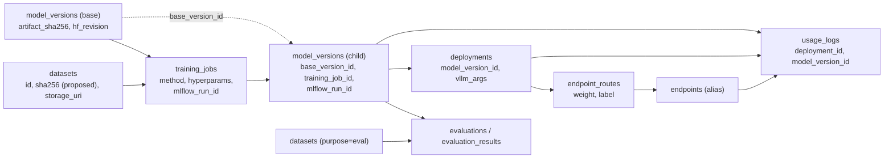
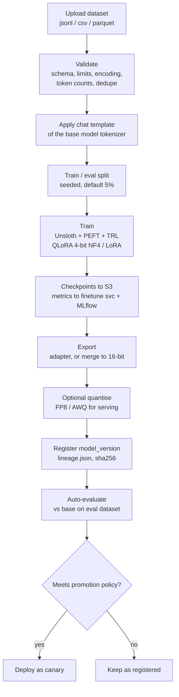

# 15 - MLOps and RAG

Covers experiment tracking, lineage, artifact layout, the fine-tuning pipeline, the RAG pipeline, vector database choice, hybrid retrieval with reranking, and the exact definitions of the evaluation metrics.
Status: **design**. The finetune, rag and evaluation services are typed stubs; the trainer image, vector-store adapter and judge pipeline are not built ([14](14-roadmap.md)). Tables referenced exist in `0001_init.sql`.

## 1. Tracking and registry integrations

### 1.1 Roles of each system

| System | Role | Source of truth for |
|---|---|---|
| PostgreSQL (`model_versions`, `training_jobs`, `evaluations`, ...) | Platform registry and lineage | What exists, who owns it, what it was derived from, its status |
| MLflow tracking server (`SLM_MLFLOW_URI`) | Experiment tracking for training and evaluation runs | Run-level params, metric time series, run artifacts (curves, reports) |
| Object storage | Large artifacts | Weights, adapters, datasets, checkpoints |
| Weights & Biases (optional, `SLM_WANDB_*`) | Tenant-chosen external tracking | Nothing authoritative; a convenience link (`training_jobs.wandb_run_url`) |
| Hugging Face Hub | Upstream source of base models and tokenizers; optional push target | Upstream weights at a pinned revision |

The MLflow *Model Registry* is **not used**: `model_versions` is the registry. This avoids two sources of truth and lets RLS govern access. `model_versions.mlflow_run_id` and `training_jobs.mlflow_run_id` link the two.

### 1.2 MLflow

- **Deployment:** one tracking server, backend store = PostgreSQL (separate database `mlflow`), artifact root = S3 (`s3://checkpoints/...` for run artifacts, `s3://reports/...` for evaluation runs).
- **Tenancy caveat (important):** open-source MLflow is not multi-tenant. Treat it as an **internal system**: tenants never get direct MLflow credentials. The platform exposes loss curves via `GET /api/v1/training-jobs/{id}/metrics` (backed by `training_metrics`) and the UI links to MLflow only for `platform_admin`. If tenant-facing access to MLflow is ever needed, front it with the MLflow authentication app plus per-experiment permissions, or a proxy that enforces `org_id` by experiment name. (The wireframe's "MLflow run [open]" link is for admin roles.)
- **Experiment naming:** `slm/{org_slug}/{project_slug}/finetune` and `.../evaluation`. Org slug is unique (`organizations.slug`); an experiment is never shared across orgs.
- **Run contents** written by the trainer / evaluation worker:

| Kind | Items |
|---|---|
| Params | `base_model`, `base_revision` (HF commit hash), `method`, all `hyperparams`, `max_seq_len`, `seed`, `gpu_count`, `precision`, `quantization` |
| Metrics (per step) | `loss`, `eval_loss`, `lr`, `grad_norm`, `tokens_per_second`, `gpu_util` (mirrors `training_metrics`) |
| Tags | `slm.org_id`, `slm.project_id`, `slm.job_id`, `slm.dataset_id`, `slm.dataset_sha256`, `slm.base_version_id`, `slm.trainer_image` (digest), `slm.git_sha`, `slm.hardware` (`gb10`/`h100`), library versions (torch, transformers, peft, trl, unsloth, bitsandbytes) |
| Artifacts | `loss_curve.png`, final `adapter_config.json`, trainer log tail, `lineage.json` (section 2) |

- The platform stores only the run **id** and reads details on demand; losing MLflow does not lose the registry (Postgres + S3 do).

### 1.3 Weights & Biases

Optional and tenant-owned: if a tenant supplies a W&B API key, the trainer logs to the tenant's own W&B project and the run URL is stored in `training_jobs.wandb_run_url`.
The key must be injected only into that job's pod as a Secret created at launch from an org-level secret store. **There is no table for tenant secrets in `0001`** (gap; use a Kubernetes Secret or Vault path `secret/orgs/{org_id}/wandb` keyed by org until a table exists). Egress for the trainer pod to W&B is allowed only for jobs that enable it ([06](06-infrastructure.md) s4).

### 1.4 Hugging Face Hub

- **Pull:** base models by `hf_repo` at a **pinned revision (commit hash)**, recorded in `model_versions.metadata.hf_revision` and `artifact_uri = hf://<repo>@<rev>` or, after mirroring, `s3://models/...`. Gated repositories (Llama, Gemma) need an `HF_TOKEN` and licence acceptance ([14](14-roadmap.md#5-model-licence-caveats)).
- **Mirror:** production deployments pull from the `models` bucket, not from the Hub (`HF_HUB_OFFLINE=1`): reproducible, faster, works air-gapped, and survives upstream deletion. A pull job copies the repo to S3, computes `artifact_sha256` over the file manifest, and rejects pickle-based weights (security DH5).
- **Push (optional):** exporting a tenant's fine-tuned model to their HF repo uses the tenant's own token, only when licence rules allow redistribution (OQ-14).
- **Tokenizer and chat template** are part of the artifact; the chat template used for training is stored with the adapter so serving uses the same formatting (a mismatch is a common silent quality loss).

## 2. Lineage and provenance



Query: full ancestry of a model version (recursive CTE over `base_version_id`), then the dataset and job that produced each hop:

```sql
WITH RECURSIVE chain AS (
  SELECT mv.id, mv.version, mv.base_version_id, mv.training_job_id, 0 AS depth
  FROM model_versions mv WHERE mv.id = $1
  UNION ALL
  SELECT p.id, p.version, p.base_version_id, p.training_job_id, c.depth + 1
  FROM model_versions p JOIN chain c ON p.id = c.base_version_id
)
SELECT c.depth, c.id AS model_version_id, tj.id AS job_id, tj.dataset_id, tj.method, tj.mlflow_run_id
FROM chain c LEFT JOIN training_jobs tj ON tj.id = c.training_job_id
ORDER BY c.depth;
```

**Provenance record (`lineage.json`)** written by the trainer next to the artifact and referenced from `model_versions.metadata`: org/project ids, job id, base version id and HF revision, dataset id + sha256 + row/token counts, hyperparameters, seed, trainer image digest, git SHA, library versions, hardware, start/end times, MLflow run id, licence inherited from the base model.
Reproducibility is **best effort, not bitwise**: GPU kernels and 4-bit quantisation are non-deterministic across hardware; the record tells you what to re-run, not that results will match exactly.

Lineage is also the answer to three operational questions: "which deployments serve a model derived from dataset X" (right-to-erasure and data-recall), "which models inherit licence Y", and "what changed between the last good and the first bad version".

## 3. Artifact layout (S3 API)

Buckets are fixed by the contract: `models`, `datasets`, `rag-documents`, `checkpoints`, `reports`. Keys are prefixed by `org_id` so IAM/bucket policies and erasure jobs can operate on a prefix.

```
models/
  _global/{model_id}/v{n}/...                      # global catalogue (org_id NULL), writable only by platform_admin
  {org_id}/{model_id}/v{n}/
     config.json  generation_config.json  tokenizer.json  tokenizer_config.json  chat_template.jinja
     model-0000x-of-0000y.safetensors              # full / merged weights, or
     adapter_config.json  adapter_model.safetensors   # LoRA/QLoRA adapter (base referenced via base_version_id)
     MANIFEST.json                                  # sha256 and size for every file; artifact_sha256 = sha256(MANIFEST.json)
     lineage.json  LICENSE
datasets/
  {org_id}/{dataset_id}/data.{jsonl|csv|parquet}   # original upload, immutable
  {org_id}/{dataset_id}/schema.json  stats.json    # detected schema, token counts
checkpoints/
  {org_id}/{job_id}/step-{n}/                      # optimizer-free adapter/weights checkpoints (resume support)
  {org_id}/{job_id}/mlflow/                        # MLflow run artifacts
rag-documents/
  {org_id}/{index_id}/{document_id}/{filename}     # original files (source of truth for re-ingestion)
reports/
  {org_id}/evaluations/{evaluation_id}/report.json  samples.jsonl
  {org_id}/usage/YYYY-MM/part-*.parquet            # exported usage_logs partitions
  anchors/YYYY-MM-DD/{chain}.json                  # audit-chain anchors, Object Lock (compliance mode)
```

| Bucket | Versioning | Lifecycle (defaults, **Assumption**) | Notes |
|---|---|---|---|
| `models` | on | Keep all versions referenced by `model_versions`; delete unreferenced after 30 days | Artifacts are immutable once `registered`: never overwrite a version path |
| `datasets` | on | Keep until the dataset row is deleted | |
| `checkpoints` | off | Keep last 3 + best per job; delete the rest 7 days after success; delete all 30 days after job end | |
| `rag-documents` | on | Keep until index/document deletion | Needed to rebuild the vector index |
| `reports` | on | Evaluations 1 year; usage exports per retention policy; anchors locked | |

## 4. Fine-tuning pipeline



Defaults (starting points, validated per use case): QLoRA, rank `r=16`, `lora_alpha=32`, dropout 0, all linear projection modules, learning rate 2e-4 with cosine schedule and 3% warmup, 1-3 epochs (more epochs overfit small datasets), effective batch 32 via gradient accumulation, `max_seq_len` 2048-4096 with sequence packing, bf16 compute, seed fixed.
Choose full fine-tuning only for sub-4B models on H100-class memory (memory table in [13](13-cost-estimation.md) s5).

| Topic | Decision |
|---|---|
| Dataset formats | Chat: `{"messages":[{"role","content"},...]}` (preferred, rendered by the tokenizer's chat template). Completion: `{"prompt","completion"}`. CSV/Parquet columns mapped in the UI |
| Validation | UTF-8, max row/token length, role ordering, empty-turn check, duplicate and near-duplicate detection, token count by the base model tokenizer (fills `datasets.token_count`), label balance summary. Reject files over the size limit; parse in a sandboxed worker ([11](11-security-checklist.md) DH7) |
| Adapter vs merged | Default: adapter only (small, enables multi-LoRA serving on one base). Merge when quantising to FP8/AWQ or when the deployment cannot use LoRA. Both are `model_versions` rows with `format = safetensors` |
| Multi-GPU | Single GPU is the default path (Unsloth). Multi-GPU (`gpu_count > 1`) support must be verified per Unsloth/TRL release; otherwise use TRL with accelerate/FSDP for larger runs. **Do not advertise multi-GPU training until tested** |
| Resume | Last checkpoint restart is Phase 3; Phase 2 treats a failed job as failed with checkpoints retained |
| Evaluation gate | Optional per-project policy: promote only if eval metrics beat the base by a configured margin with CI excluding 0 (section 8.7) |
| Cost control | `quotas.max_gpu_hours` checked at submit; `est_cost_usd` shown; `activeDeadlineSeconds` bounds runaway jobs ([13](13-cost-estimation.md)) |
| Data governance | Datasets are used only for that org's jobs; deletion of a dataset does not delete derived models (lineage records keep the id); erasure policy in [11](11-security-checklist.md) |

Trainer job contract (`SLM_JOB_SPEC`, JSON):

```json
{"job_id":"...","org_id":"...","base":{"uri":"s3://models/.../v1","revision":"<sha>"},
 "dataset":{"uri":"s3://datasets/.../data.jsonl","format":"jsonl","sha256":"..."},
 "method":"qlora","hyperparams":{"learning_rate":2e-4,"epochs":3,"lora_r":16,"lora_alpha":32,"max_seq_len":4096},
 "output":{"model_prefix":"s3://models/<org>/<model>/v4/","checkpoint_prefix":"s3://checkpoints/<org>/<job>/"},
 "callback":{"url":"http://finetune.slm-control:8003/internal/jobs/<job>/events","token":"<job-scoped>"},
 "mlflow":{"uri":"http://mlflow.slm-data:5000","experiment":"slm/acme/support/finetune"}}
```

## 5. RAG pipeline

```mermaid
flowchart TD
    subgraph ingest["Ingestion (async worker, per document)"]
      u["Upload"] --> s["Store original<br/>rag-documents bucket"]
      s --> p["Parse<br/>PDF DOCX HTML MD TXT<br/>sandboxed"]
      p --> c["Clean + structure<br/>headings, tables, page numbers"]
      c --> ch["Chunk<br/>token-aware, overlap<br/>chunk_size / chunk_overlap"]
      ch --> m["Metadata<br/>doc_id, chunk_no, page, section,<br/>content hash"]
      m --> e["Embed<br/>dense (+ sparse)"]
      e --> v["Upsert to vector DB<br/>payload: org_id, index_id, ..."]
      v --> st["Update rag_documents,<br/>rag_indexes counts"]
    end
    subgraph query["Query"]
      q["User query"] --> qe["Embed query<br/>dense + sparse"]
      qe --> hs["Hybrid retrieve<br/>dense top 50 + sparse top 50<br/>filter org_id, index_id"]
      hs --> fu["Fuse (RRF)"]
      fu --> rr["Rerank cross-encoder<br/>top 5-8"]
      rr --> as["Assemble context<br/>dedupe, order, token budget"]
      as --> g["Generate via gateway<br/>citations required"]
      g --> chk["Post-check<br/>citation validity,<br/>optional groundedness"]
    end
```



| Stage | Design |
|---|---|
| Parsing | Dedicated parser per MIME type in a resource-limited sandbox (CPU/memory/time caps, no network). Extract text and structure (headings, tables as Markdown); keep page numbers for citations. OCR is optional and off by default |
| Chunking | Token-aware recursive splitting on structure boundaries (heading, paragraph, sentence), then token windows. Defaults from the schema: `chunk_size = 512`, `chunk_overlap = 64` tokens, counted with the **embedding model's tokenizer**. Do not exceed the embedding model's max input. Optional parent-child: embed small chunks, return the parent section for context |
| Embedding | Served by vLLM pooling/embedding deployments through the same gateway (`/v1/embeddings`), so embedding traffic is metered and rate-limited. Batch 32-128 chunks per call. `embedding_model` and `embedding_dim` are fixed per index |
| Idempotency | Chunk id = hash(`doc_id`, `chunk_no`, content hash). Re-ingesting a document deletes its points by `doc_id` filter then upserts: no duplicates, no orphans |
| Deletion | Delete document = delete points by `doc_id`; delete index = delete by `index_id` (or drop the dedicated collection); both also delete the S3 originals |
| Updating the embedding model | Create a **new** index, re-ingest from `rag-documents`, switch consumers by alias, delete the old index (blue/green) |
| Isolation | Server-added `org_id` + `index_id` filter on every operation; document-level ACL metadata is a later feature; retrieved text is untrusted input to the generator ([11](11-security-checklist.md) DH9, DH10) |
| Generation | Prompt = system policy + numbered passages (with ids) + question; require citations as passage ids; instruct to answer "not in the documents" when unsupported; cap context at <= 50% of `max_model_len` |
| Failure handling | Per-document `status` and `error` (`rag_documents`); poison documents do not block the index; retry with backoff; dead-letter after N attempts |

Embedding models (candidates; verify licence and fit at adoption): BGE-M3 (MIT; 1024-d dense plus sparse lexical weights plus multi-vector, 8k context, multilingual), multilingual-E5-large (MIT; 1024-d), nomic-embed-text v1.5 (Apache-2.0; 768-d, Matryoshka), Qwen3-Embedding family (Apache-2.0; sizes 0.6B-8B).
Default recommendation: **BGE-M3**, because one model yields dense and sparse representations for hybrid search with a single forward pass.

Vector memory sizing: `vectors x dim x bytes_per_component`. 5 M chunks x 1,024 x 4 B = 20.5 GB float32; scalar int8 quantisation is 5.1 GB in RAM with originals on disk for rescoring; add HNSW graph overhead (~5-10% at m=16) and ~1.3x headroom.

## 6. Vector database comparison and recommendation

Properties below are as of writing for the open-source editions; verify versions you deploy.

| Criterion | Qdrant | Weaviate | Milvus |
|---|---|---|---|
| Licence | Apache-2.0 | BSD-3-Clause | Apache-2.0 |
| Implementation / footprint | Rust, single binary, low memory overhead | Go, single binary, higher memory use | Go/C++, microservice architecture (standalone mode available); cluster needs metadata store, message queue and object storage |
| ANN indexes | HNSW (filterable), on-disk option | HNSW, flat, dynamic | HNSW, IVF family, DiskANN, GPU indexes (CAGRA) |
| Hybrid search | Dense + sparse vectors in one collection; Query API with prefetch and server-side fusion (RRF, DBSF); multivectors (late interaction) | Built-in BM25F + vector hybrid with fusion modes; no separate sparse model needed | Dense + sparse (and a BM25 function in recent versions) with hybrid search and rerankers |
| Multi-tenancy | Payload-based partitioning in a shared collection (tenant payload index) or collection per tenant; strong filtered search | **Native** tenants (each a shard, hot/cold tenant states); very many tenants per class | Partition-key or collection/database per tenant; heavier objects |
| Quantisation | Scalar, product, binary; rescoring | PQ, BQ, SQ, RQ | PQ, SQ, binary variants |
| Scale | Millions to hundreds of millions of vectors per cluster; sharding + replication (Raft) | Similar; replication and sharding | Designed for billions; horizontal scale |
| Operations | Simplest to run; snapshots; official Helm chart; arm64 images | Moderate; backup modules; Helm chart | Highest; many components in cluster mode |
| Fit for DGX Spark | Excellent (small footprint on a 128 GB shared box) | Good | Poor in cluster mode; standalone acceptable |
| API | REST + gRPC, good Python client | GraphQL + REST + gRPC | gRPC/REST, Python client |

**Recommendation: Qdrant is the default backend** (`rag_indexes.backend = 'qdrant'`, the schema default): smallest operational footprint (important on a single Spark), first-class sparse+dense hybrid with server-side fusion (matches the design in section 7), payload-based multi-tenancy that scales to thousands of orgs without thousands of collections, quantisation to control memory.
Choose **Weaviate** when native per-tenant lifecycle (offloading idle tenants) or built-in BM25 without a sparse model matters more than footprint. Choose **Milvus** only beyond roughly hundreds of millions of vectors per cluster or when GPU-built indexes are required and you can staff the operations.
The enum `vector_backend` already allows all three; implement a small `VectorStore` interface (`ensure_collection`, `upsert`, `delete_by_filter`, `hybrid_search`, `count`, `drop`) and ship Qdrant first; keep contract tests so a second backend passes the same suite.

Qdrant layout (**Proposed**):

- One shared collection per `(embedding_model, embedding_dim)`, named `slm_{model}_{dim}`; named vectors `dense` (cosine) and `sparse`; payload `org_id`, `index_id`, `doc_id`, `chunk_no`, `page`, `text`, `meta`.
- Payload indexes on `org_id` (tenant-optimised) and `index_id`; HNSW `m=16`, `ef_construct=128`, query `hnsw_ef` 64-128; scalar int8 quantisation with `always_ram` and rescoring.
- Large or regulated tenants: a dedicated collection (`rag_indexes.collection` names it), optionally on dedicated nodes.
- Qdrant is reachable only from the `rag` service (NetworkPolicy and API key); tenants never talk to it.
- Backups: snapshots to S3 daily; authoritative fallback is re-ingestion from `rag-documents` ([06](06-infrastructure.md) s7).

## 7. Hybrid search and reranking design

```
query -> dense vector  (embedding model)         -> top N_dense  = 50   (cosine)
      -> sparse vector (BM25-style / BGE-M3 lexical weights) -> top N_sparse = 50
      -> fuse with Reciprocal Rank Fusion:  score(d) = sum over lists of 1 / (k + rank_list(d)),  k = 60
      -> keep top N_fused = 30-50
      -> cross-encoder rerank (query, passage) -> top_k = 5-8
```

Why: dense retrieval captures paraphrase and semantics, sparse captures exact terms (identifiers, error codes, names, numbers) where embeddings are weak; their errors are largely complementary.
RRF needs no score normalisation across incompatible score scales (cosine vs BM25) and is robust with a single parameter; weighted score fusion after min-max normalisation is more tunable but fragile and should be used only with a tuning set.

| Parameter | Default | Where set |
|---|---|---|
| `hybrid_search` | true | `rag_indexes.hybrid_search`; false = dense only |
| `reranker_model` | none or `bge-reranker-v2-m3` (Apache-2.0; verify) | `rag_indexes.reranker_model` |
| `N_dense`, `N_sparse`, `N_fused`, `top_k`, RRF `k` | 50, 50, 40, 5, 60 | Service defaults, overridable per query (`top_k`, `rerank`) |
| Metadata filters | Optional document-level filters | Query body `filters`; `org_id`/`index_id` always forced |
| Context budget | `top_k x chunk_size <= 0.5 x max_model_len` | Prompt assembly |

Reranker serving: a cross-encoder scores `N_fused` (query, passage) pairs (about 512 tokens each). It is served by vLLM as a pooling/score model or a dedicated inference container, reached through the gateway for metering.
Latency estimate (**Assumption**): 40 pairs x 512 tokens = ~20k tokens through a 568M-parameter model is ~23 TFLOP: roughly 0.1-0.2 s on an H100 and about 1 s on a Spark; on Spark reduce `N_fused` to 20-30 or skip reranking for latency-critical paths.

Latency budget for the retrieval part: query embed 10-50 ms, ANN + fusion 20-80 ms, rerank 100-1,000 ms, then generation TTFT per [12](12-monitoring-design.md) S2. Stage timings are exported as `slm_rag_query_seconds{stage}`.

Optional enhancements (each must show gain on the retrieval evaluation set before enabling): query rewriting/expansion (HyDE or LLM rewrite, adds an LLM call), MMR diversification, parent-child retrieval, metadata boosting by recency.
**Evaluate retrieval separately from generation** on a labelled set of (query, relevant chunk ids): recall@k (k = 5, 20, 50), MRR@10, nDCG@10; compare dense-only vs hybrid vs hybrid+rerank. Most RAG quality problems are retrieval problems; the faithfulness metrics below will not distinguish them without this.

## 8. Evaluation metric definitions

Metric names match `evaluations.metrics` (`accuracy, f1, rouge, bleu, hallucination, faithfulness, groundedness, toxicity, json_validity`); per-model results go to `evaluation_results.scores` (JSONB), latency to `latency_p50_ms`/`latency_p95_ms`, and cost to `cost_per_1k_tokens_usd`.
Per-sample outputs and judge verdicts go to `reports/{org_id}/evaluations/{id}/samples.jsonl`. Every score is reported with `n` (sample count: `evaluation_results.sample_count`) and a 95% CI.

### 8.1 Reference-based metrics

| Metric | Definition | Notes |
|---|---|---|
| `accuracy` | `correct / n`. Short-answer tasks: exact match after normalisation (lowercase, strip punctuation and articles, collapse whitespace); multiple choice: parsed option equals gold; classification: predicted label equals gold | Normalisation function is versioned and recorded |
| `f1` | Generation: token-level F1 per sample, `2PR/(P+R)` with P and R from bag-of-token overlap with the reference (SQuAD-style), averaged. Classification datasets (a `label` field): macro-F1 over classes | Which variant applied is recorded in `scores` metadata |
| `rouge` | ROUGE-L F-measure (longest common subsequence) via `rouge-score` with stemming; `scores` also carries `rouge1`, `rouge2`, `rougeL` | Summarisation; weakly correlated with quality for abstractive output |
| `bleu` | Corpus-level sacreBLEU (4-gram, tokenizer `13a`, exponential smoothing), signature string stored | Translation-like tasks; do not compare across tokenizers |
| `json_validity` | Fraction of outputs that (1) parse as a single JSON value per RFC 8259 after stripping a Markdown code fence, and (2) when the dataset row carries a JSON Schema, validate against it. Report both `parse_rate` and `schema_valid_rate` | Deterministic; critical for tool/structured-output use |
| `toxicity` | Fraction of outputs whose toxicity probability from a reference classifier is >= 0.5 (also report the mean score). **Lower is better.** Classifier: an open toxicity model (for example a toxic-BERT family model; verify its licence) | Classifier bias and language coverage limit validity; indicative only |

### 8.2 Judge-based metrics: faithfulness, groundedness, hallucination

These apply to **context-grounded** tasks (RAG, summarisation, extraction): each sample has a source context `C` (retrieved passages or the provided document), a question `q`, and a model answer `A`. A judge model (`evaluations.judge_model`, an endpoint alias) produces structured verdicts.

**Faithfulness** (claim-level; RAGAS-style):

1. *Decompose*: the judge splits `A` into atomic, self-contained factual claims `c_1..c_m` (pronouns resolved, one fact each).
2. *Verify*: for each `c_i`, the judge, given only `C` and `c_i`, returns a verdict in {`supported`, `contradicted`, `unverifiable`} with a quoted evidence span.
3. `faithfulness(sample) = |{c_i : supported}| / m`. If `m = 0` (refusal or empty answer), the sample is marked `abstained` and excluded from the mean (the abstention rate is reported separately).
4. Dataset score = mean over non-abstained samples.

**Groundedness** (sentence-level support strength and citation correctness):

1. Split `A` into sentences `s_1..s_k`.
2. For each `s_j`, compute `g_j = max over passages p in C of E(p, s_j)`, where `E` is the entailment probability of an NLI cross-encoder (deterministic, cheap) or a judge score in [0,1].
3. `groundedness(sample) = (1/k) * sum_j g_j`; the reported "grounded fraction" is the share of sentences with `g_j >= tau` (`tau = 0.5` default).
4. If the answer cites passages, also compute `citation_precision = (# citations whose cited passage entails the sentence it supports) / (# citations)`.

*Faithfulness vs groundedness:* faithfulness asks "what fraction of the answer's atomic claims does the context support" (strict, claim-level, judge-based). Groundedness asks "how strongly is each sentence supported by some passage, and do citations point at the right evidence" (graded, sentence-level, NLI-based). They correlate but are not interchangeable; both are reported when selected. Neither says anything about whether the answer is *correct* in the world, only whether it is supported by `C`.

**Hallucination rate** (response-level, with intrinsic/extrinsic split):

- `h(A) = 1` if any claim of `A` is `contradicted` (**intrinsic** hallucination, conflicts with `C`) or `unverifiable` (**extrinsic**, not supported by `C`); otherwise `0`. `hallucination = mean_i h(A_i)` over non-abstained samples.
- Also stored: `hallucination_intrinsic`, `hallucination_extrinsic` rates and the **claim-level rate** `1 - faithfulness`. Response-level rate is always >= claim-level rate; reporting only one hides the other.
- Closed-book tasks (no context): `C` is replaced by the dataset reference answer/facts; only `contradicted` claims count (an unverifiable claim relative to a short reference is not evidence of hallucination). Records the mode used.
- Lower is better; do not present it as "truthfulness".

```text
def faithfulness(question, answer, context, judge):
    claims = judge.extract_claims(answer)                    # JSON list, temperature 0
    if not claims: return None                               # abstained
    verdicts = [judge.verify(context, c) for c in claims]    # supported | contradicted | unverifiable
    return sum(v == "supported" for v in verdicts) / len(claims)
```

### 8.3 Judge protocol (applies to every judge-based metric)

| Rule | Reason |
|---|---|
| Judge is a **different model** (preferably a different family and at least as capable) from every candidate; the UI warns otherwise | Self-preference bias |
| Temperature 0, structured JSON output enforced (`response_format` / guided decoding), versioned prompts (`judge_prompt_version` stored with results) | Reproducibility, parseability |
| Judge sees only `C`, `q`, claim/answer, never model names | Blinding |
| Pairwise comparisons: run both orders (A,B) and (B,A); count a win only if consistent | Position bias |
| Retry on parse failure up to 2 times, then mark the sample `judge_error` and exclude it (reported) | Do not silently bias scores |
| Judge calls are routed through the gateway as the org (metered, rate-limited, costed) | Cost transparency |
| Verbosity/length bias check: report mean answer length alongside | Longer answers contain more claims |

### 8.4 Calibration and trust

An SLM judge is weaker than a frontier judge. A judge-based metric is labelled **indicative** unless it has been calibrated: take >= 200 samples labelled by humans (claim support yes/no), compute Cohen's kappa between judge and humans (target >= 0.6) and the judge's precision/recall for hallucination flags; store the calibration run id with the metric configuration.
For groundedness, an NLI cross-encoder is preferred over a small LLM judge because it is deterministic and cheaper; re-check it on the human set.

### 8.5 Statistical treatment

- Confidence intervals: percentile bootstrap, 1,000 resamples of samples, 95%. Shown in the UI and exports.
- Comparing two models on the same samples: **paired** bootstrap on per-sample differences; declare a difference only if the 95% CI excludes 0. The "delta" chips in the compare view use this.
- Sample size for a proportion metric (accuracy, hallucination rate) with +/-3 points at 95% confidence: n ~ 1,067 (worst case p = 0.5); +/-5 points: n ~ 385. Warn when `sample_count` is below 200.
- Multiple metrics and comparisons inflate false positives; treat 5+ simultaneous deltas as exploratory.

### 8.6 Latency and cost columns

`latency_p50_ms` / `latency_p95_ms`: end-to-end latency of the evaluation's own requests through the gateway at a fixed concurrency (default 4), non-streaming, excluding failed requests; TTFT and tokens/s are stored in `scores` metadata.
`cost_per_1k_tokens_usd`: blended `(prompt x input_rate + completion x output_rate) / total_tokens x 1000` using the cost model for the model version's serving class ([13](13-cost-estimation.md)). Enables the quality-per-dollar comparison between a base model and its fine-tune.

### 8.7 Promotion policy (optional gate)

A fine-tuned version may be auto-promoted to canary only if, on the eval dataset: the primary metric improves by at least `delta_min` with a paired-bootstrap CI excluding 0; `hallucination`/`toxicity` do not worsen beyond `epsilon`; `json_validity` does not regress; p95 latency regression is within the budget. The rule is configuration per project, and every promotion decision is written to `audit_logs` with the evaluation id.

### 8.8 Known pitfalls

Contamination (eval data present in the base model's pretraining or in the fine-tune dataset: check overlap by n-gram hash and refuse an eval dataset that overlaps the training dataset of the candidate); prompt-format sensitivity (evaluate with the same chat template used in production); small-sample noise (see CIs); metric gaming through verbosity; judge drift when the judge model is upgraded (re-run the calibration, store judge version).
